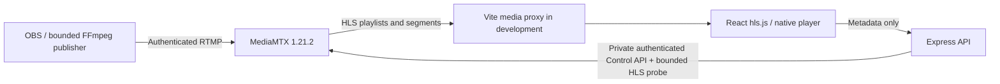

# StreamShield architecture

## Implemented: foundation and real live video

An npm workspace contains React/Vite (`apps/web`), Express (`services/api`) and small Zod contracts (`packages/shared`). The foundation remains intact: strict configuration, request IDs, structured logging, bounded JSON input, CORS, liveness/readiness and graceful API draining. React Router adds a watch route; TanStack Query polls actual observations. There are no user accounts, database or administrative application routes yet.

Express does not transport video to viewers. `/media` is a configured development proxy from Vite directly to MediaMTX; the production equivalent belongs in a dedicated edge/reverse proxy. Its request rewrite and `Location` response rewrite preserve HLS session negotiation in a subfolder. Public HLS base URLs can alternatively identify a directly reachable origin with appropriate CORS.

## Media origin and publishing authority

The pinned official `bluenviron/mediamtx:1.21.2-ffmpeg` image includes HTTP probe utilities and the upstream FFmpeg variant. Only RTMP, HLS and the private control API are enabled. Paths, ports, origins, deadlines and HLS sizing come from validated configuration. One configured development path accepts one authenticated publisher; `overridePublisher: false` prevents silent source takeover. Viewers may read that one public development channel. No arbitrary/all-other paths are configured.

`npm run setup:media` preserves existing nonempty environment settings, adds missing defaults, creates high-entropy local credentials and renders the checked-in fail-closed template into ignored `.local/mediamtx.yml`. Runtime YAML stores password hashes; plain local credentials remain in ignored `.env`. Publishing and control credentials are distinct and never returned by the API or bundled as `VITE_` values. Standard Compose publishes only RTMP/HLS and application ports on loopback. The control API is private; the opt-in local npm override publishes it only on host loopback and still requires authentication from the application.

This development path uses unencrypted RTMP/HTTP. Non-development setup is rejected. A deployment must separately design TLS/RTMPS, rotation/secret injection, publisher authorization and viewer access. MediaMTX API permissions are broad within that private control plane; the backend exposes only a fixed read observation, never an arbitrary control proxy. Docker sockets are not mounted.

## Observation and playback semantics

| Stream state | Evidence                                                                         | Meaning                                                          |
| ------------ | -------------------------------------------------------------------------------- | ---------------------------------------------------------------- |
| offline      | Origin responds but configured publisher is absent/not online                    | No active source; not an origin outage                           |
| starting     | Publisher online, but source availability or HLS manifest cannot yet be verified | Do not claim playable video                                      |
| live         | Source online/available and a bounded HLS manifest probe succeeds                | Source/manifest available; not proof of every browser's decoding |
| unavailable  | API unreachable, unauthorized, invalid or otherwise unverifiable                 | Publisher state unknown, not fabricated offline                  |

Probe reads are not real viewer sessions and must not be counted as audience statistics. Each result includes `publisher`, `hls`, `reason`, `checkedAt`, safe playback URL and observed codec names. Control requests have a shared deadline with the HLS probe. Requests coalesce and use a short configurable cache; timestamps identify the observation age. A failed refresh does not show cached data as current healthy state. API readiness means this application is accepting requests; it deliberately remains separate from origin availability so the UI can explain a media outage.

Hls.js is loaded on the watch route when supported, with native HLS fallback. The browser reports loading, playing, paused, buffering, autoplay-blocked, reconnecting, error and unsupported states from actual media behavior. A no-progress watchdog and fatal errors trigger a bounded per-session retry budget with exponential delay/cap. Manual retry creates a fresh budget. A newly verified publisher session can reattach playback. Muted startup respects autoplay restrictions, and all HLS instances/listeners/timers are released on unmount. A player reconnect is not infrastructure healing.

MediaMTX remuxes rather than transcodes. H.264/yuv420p with AAC and regular keyframes is the verified FFmpeg path. HLS buffering delays source interruption visibility; process, publisher, playlist and decoded playback health must remain separate signals. Tests verify segment bytes and actual decoded browser frames/time progression, not just an open port or a manifest request.

## Future phases (not implemented)

Phase 3 adds PostgreSQL for durable accounts/streams and Redis for ephemeral presence, chat and bounded rate limits. Authentication, role-based permissions, session management and scoped/rotatable publishing authorization precede protected management APIs. The configured development channel can evolve into durable stream records without replacing the player or observed contracts.

Phase 4 adds Nginx API balancing and video edges. Standby media needs explicit replication or independent publishing; a second container alone cannot preserve a source. HLS caching, playlist freshness, origin/edge bandwidth and player reconnect behavior require separate measurements.

Phases 5–7 add an independent control plane: probes/metrics, durable incidents, bounded predefined playbooks, verification, narrowly scoped authority, audited chaos experiments and expiry. Each recovery action needs a trigger, observable evidence, timeout, cooldown and retry budget. Restart success never substitutes for user-facing recovery. No public Docker control or unauthenticated chaos endpoints are permitted.

Phases 8–10 validate load/resilience and production deployment. The 50,000–60,000 viewer goal is an untested architectural target. API RPS, virtual users, HLS consumers and genuinely playing browsers are different workloads. This single origin and development Vite server provide no redundancy, capacity or availability guarantee. Future decisions include identity/session design, media replication, CDN policy, controller privileges and distributed test budgets.

## Consumer and operations separation

StreamShield Live owns `/`, `/live`, `/search`, `/explore` and `/watch/:id` through a full-width shared shell. Discovery and sidebar share a single React Query stream list. Search operates on verified API channel metadata. The existing player lifecycle and media transport remain unchanged. `/diagnostics` contains application health; Watch mounts these checks only inside expanded diagnostics. `/foundation` redirects for compatibility.

StreamShield Control has a separate `/control` product notice. It exposes no operational capabilities. Authentication and authorization must precede future operations tooling. See [UI redesign](docs/UI_REDESIGN.md).
