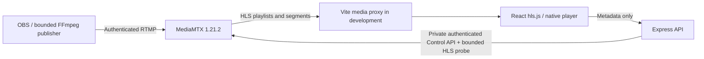
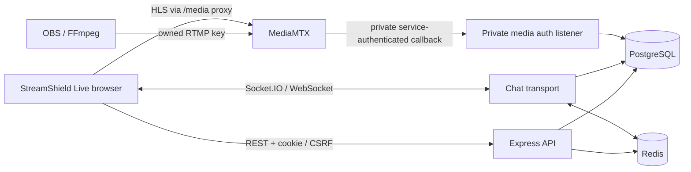

# StreamShield architecture

## Implemented: foundation and real live video

An npm workspace contains React/Vite (`apps/web`), Express (`services/api`) and small Zod contracts (`packages/shared`). The foundation remains intact: strict configuration, request IDs, structured logging, bounded JSON input, CORS, liveness/readiness and graceful API draining. React Router adds a watch route; TanStack Query polls actual observations. There are no user accounts, database or administrative application routes yet.

Express does not transport video to viewers. `/media` is a configured development proxy from Vite directly to MediaMTX; the production equivalent belongs in a dedicated edge/reverse proxy. Its request rewrite and `Location` response rewrite preserve HLS session negotiation in a subfolder. Public HLS base URLs can alternatively identify a directly reachable origin with appropriate CORS.

## Media origin and publishing authority

The pinned official `bluenviron/mediamtx:1.21.2-ffmpeg` image includes HTTP probe utilities and the upstream FFmpeg variant. Only RTMP, HLS and the private control API are enabled. Paths, ports, origins, deadlines and HLS sizing come from validated configuration. One configured development path accepts one authenticated publisher; `overridePublisher: false` prevents silent source takeover. Viewers may read that one public development channel. No arbitrary/all-other paths are configured.

`npm run setup:media` preserves existing nonempty environment settings, adds missing defaults, creates high-entropy local credentials and renders the checked-in fail-closed template into ignored `.local/mediamtx.yml`. Runtime YAML stores password hashes; plain local credentials remain in ignored `.env`. Publishing and control credentials are distinct and never returned by the API or bundled as `VITE_` values. Standard Compose publishes only RTMP/HLS and application ports on loopback. The control API is private; the opt-in local npm override publishes it only on host loopback and still requires authentication from the application.

This development path uses unencrypted RTMP/HTTP. Non-development setup is rejected. A deployment must separately design TLS/RTMPS, rotation/secret injection, publisher authorization and viewer access. MediaMTX API permissions are broad within that private control plane; the backend exposes only a fixed read observation, never an arbitrary control proxy. Docker sockets are not mounted.

## Observation and playback semantics

| Stream state | Evidence                                                                         | Meaning                                                          |
| ------------ | -------------------------------------------------------------------------------- | ---------------------------------------------------------------- |
| offline      | Origin responds but configured publisher is absent/not online                    | No active source; not an origin outage                           |
| starting     | Publisher online, but source availability or HLS manifest cannot yet be verified | Do not claim playable video                                      |
| live         | Source online/available and a bounded HLS manifest probe succeeds                | Source/manifest available; not proof of every browser's decoding |
| unavailable  | API unreachable, unauthorized, invalid or otherwise unverifiable                 | Publisher state unknown, not fabricated offline                  |

Probe reads are not real viewer sessions and must not be counted as audience statistics. Each result includes `publisher`, `hls`, `reason`, `checkedAt`, safe playback URL and observed codec names. Control requests have a shared deadline with the HLS probe. Requests coalesce and use a short configurable cache; timestamps identify the observation age. A failed refresh does not show cached data as current healthy state. API readiness means this application is accepting requests; it deliberately remains separate from origin availability so the UI can explain a media outage.

Hls.js is loaded on the watch route when supported, with native HLS fallback. The browser reports loading, playing, paused, buffering, autoplay-blocked, reconnecting, error and unsupported states from actual media behavior. A no-progress watchdog and fatal errors trigger a bounded per-session retry budget with exponential delay/cap. Manual retry creates a fresh budget. A newly verified publisher session can reattach playback. Muted startup respects autoplay restrictions, and all HLS instances/listeners/timers are released on unmount. A player reconnect is not infrastructure healing.

MediaMTX remuxes rather than transcodes. H.264/yuv420p with AAC and regular keyframes is the verified FFmpeg path. HLS buffering delays source interruption visibility; process, publisher, playlist and decoded playback health must remain separate signals. Tests verify segment bytes and actual decoded browser frames/time progression, not just an open port or a manifest request.

## Future phases (not implemented)

Phase 3 adds PostgreSQL for durable accounts/streams and Redis for ephemeral presence, chat and bounded rate limits. Authentication, role-based permissions, session management and scoped/rotatable publishing authorization precede protected management APIs. The configured development channel can evolve into durable stream records without replacing the player or observed contracts.

Phase 4 adds Nginx API balancing and video edges. Standby media needs explicit replication or independent publishing; a second container alone cannot preserve a source. HLS caching, playlist freshness, origin/edge bandwidth and player reconnect behavior require separate measurements.

Phases 5–7 add an independent control plane: probes/metrics, durable incidents, bounded predefined playbooks, verification, narrowly scoped authority, audited chaos experiments and expiry. Each recovery action needs a trigger, observable evidence, timeout, cooldown and retry budget. Restart success never substitutes for user-facing recovery. No public Docker control or unauthenticated chaos endpoints are permitted.

Phases 8–10 validate load/resilience and production deployment. The 50,000–60,000 viewer goal is an untested architectural target. API RPS, virtual users, HLS consumers and genuinely playing browsers are different workloads. This single origin and development Vite server provide no redundancy, capacity or availability guarantee. Future decisions include identity/session design, media replication, CDN policy, controller privileges and distributed test budgets.

## Consumer and operations separation

StreamShield Live owns `/`, `/live`, `/search`, `/explore` and `/watch/:id` through a full-width shared shell. Discovery and sidebar share a single React Query stream list. Search operates on verified API channel metadata. The existing player lifecycle and media transport remain unchanged. `/diagnostics` contains application health; Watch mounts these checks only inside expanded diagnostics. `/foundation` redirects for compatibility.

StreamShield Control has a separate `/control` product notice. It exposes no operational capabilities. Authentication and authorization must precede future operations tooling. See [UI redesign](docs/UI_REDESIGN.md).

## Browser observation boundary

Shared `PlaybackEvent`, `PlaybackMetrics` and `PlaybackObservation` interfaces carry source ID, event timestamp, elapsed monotonic time and sanitized error classifications. The reusable player accepts an optional observation subscriber; callback changes do not recreate HLS. Each source/manual session owns a bounded-memory recorder and releases it alongside HLS, listeners and retry timers. No playback URLs, raw library errors, event history or publishing credentials are sent to diagnostics.

Startup is measured to first advancing unpaused media time, not manifest delivery. Waiting/stalled events after startup and no-progress retries identify interruptions; duplicate notifications form one stall until progress or user pause. Measured duration excludes user pauses. Reopening a source resets its media-time baseline so recovery is observable even when the new timeline begins at zero. Metrics are snapshots at event timestamps, not continuous wall-clock counters. Native HLS cannot expose network-level manifest/segment events through the video element. Source 404/410 errors are delivery observations, not proof that a broadcaster disconnected. Backend availability remains separately authoritative for publisher observations.

Future monitoring can consume this callback and correlate independently verified source/edge health; this phase adds no telemetry ingestion, persistence, failover, chaos or healing controller. `/about` preserves developer foundation/roadmap information outside consumer discovery.

## Phase 3 application and data plane

PostgreSQL owns users, canonical unique accounts, channels/ownership, streams/unique media paths, hashed revocable sessions, hashed independent publish credentials and ordered chat. node-pg-migrate applies explicit transactional forward migrations through a one-shot Compose service; named-volume data is never reset automatically. pg is the single query/pooling layer.

Authentication uses Argon2id, random HttpOnly SameSite cookies, database expiry/revocation, exact Origin checks and nonce-bound HMAC CSRF tokens. Privileged operations validate current server-side roles and resource ownership; registration cannot select roles. Account/channel/profile/chat DTOs omit private hashes. The private media callback requires its service Basic credential on a separate unexposed listener, not forwarded headers or a public admin proxy.

Each owned stream has an independent random media path and credential digest. Publishing authorization checks path/key/state/owner role; rotation/end revoke and kick matching active RTMP connections through the private Control API. Actual media evidence remains independent of DB draft/ready/ended metadata. Public HLS reads bypass per-segment DB authentication, and application cookies are stripped by the HLS proxy while MediaMTX cookies are preserved.

The supported Socket.IO Redis adapter uses separate pub/sub clients and namespaced channels. PostgreSQL is durable message history; Redis is ephemeral distribution, shared atomic rate limits and TTL presence. Messages are session-validated and stream-room scoped. Browser display is plain React text with bounded history and scrollback-aware autoscroll. Redis transport failures are explicit, with bounded reconnect and durable-history catch-up; Pub/Sub delivery durability is not claimed.

Presence counts distinct browser login/anonymous identities per stream with socket leases, based on actual advancing visible video time. Tabs sharing a session are deduplicated; pause, visibility, disconnect and expiry remove leases. Counts are approximate active players, not unique humans or complete HLS audience measurements.

DB/Redis readiness is independent of already-ingested HLS. Failed metadata refresh retains the active player and labels status unknown. Independent-instance integration verifies shared session/chat/rate/presence boundaries without introducing Phase 4 replica deployment. See [Phase 3 handoff](docs/PHASE_3.md) for schema, endpoints, limitations, migration/testing and future edge/origin extension points.

## Phase 4 optional redundant topology

The lightweight Phase 3 deployment remains the default. setup:resilience generates a validated private overlay for two independently identified APIs behind Nginx, two Nginx HLS edges behind a video gateway, and primary/standby MediaMTX packagers pulling the authenticated relay's dynamic paths over RTSP/TCP. PostgreSQL sessions/data and Redis adapter/limits/presence remain shared; no schema reset is introduced.

Public HLS paths distinguish origin timelines. Each edge proxies one selected origin per URL, bypasses live playlist caches and bounds immutable segment caching. A private MediaMTX HLS CDN credential prevents edge/session-cookie mismatches. Edge transport loss retries the same-origin URL through another edge; origin loss triggers bounded player reinitialization on a different explicit source. Restored peers resolve through Docker DNS, with explicit preferred-source retry for stable failback.

API routing uses OSS passive checks and bounded retries, without non-idempotent public write replay. Private instance diagnostics require service authentication. WebSocket-only Socket.IO remains compatible with round-robin routing and the supported Redis adapter. The existing media/player metrics are extended with safe source-selection events, not a fabricated monitoring/healing UI.

The relay warming hook keeps both origin paths supplied while a publisher exists; it is not a general service controller. Relay, gateways, web, PostgreSQL, Redis and Docker host remain single points of failure. See [Phase 4 architecture/evidence](docs/PHASE_4.md) and [plan](docs/PHASE_4_PLAN.md) for topology, security, operations and measured failure results. No host-level HA or audience-capacity claim follows.

## Phase 5 independent observation layer

The optional monitoring composition retains Phase 4 media and control flows and adds an independent Node observer, private Prometheus, provisioned Grafana and six maintained exporters. Fourteen actual components are inventoried; observation continues without any dashboard browser. API process/HTTP/socket instrumentation uses the maintained official Prometheus JS client on the authenticated internal listener. Nginx stub_status exposes supported connection/request counters only; MediaMTX, Redis and PostgreSQL supply native/exporter signals. No host collector or Docker socket is used.

The observer uses bounded jittered worker probes and an independent slower publisher/HLS/segment loop. Transactional PostgreSQL snapshots, deduplicated active incidents and append-only lifecycle events survive restart. First response, thresholded verification, UTC ordering, monotonic confirmation delay and test injection clocks are separate. A bounded latest-per-component buffer reconciles observations after persistence outage; it is explicitly not a durable journal. The observer database role can modify only monitoring tables/sequences, and its environment contains no platform session/CSRF/publishing credentials. Redis loss permits bounded process-local admission for administrator read-only monitoring; fresh database authorization is still required.

Existing Socket.IO distributes version-1 invalidation hints to revalidated administrator rooms; REST snapshots are authoritative after connect/reconnect and periodic reconciliation. Stale observation timestamps make every displayed component UNKNOWN. Ordinary users receive no operational data. The separate full-width Control product contains live metric charts, configured dependency topology, service details and paginated/filterable incident history/details. Static Phase 4 measurements remain historical documentation. No automatic action/chaos UI exists.

See [Phase 5 architecture, operation, contracts and limitations](docs/PHASE_5.md). Earlier sections describe their respective historical phases; this section and the latest phase documentation describe current capabilities. Future Phase 6 requires a separate audited action controller and narrow execution authority, rather than interpreting status changes as actions.

## Phase 6 independent recovery layer

The optional healing composition adds a separately deployed TypeScript Healer, a narrow private Docker control adapter and a read-only external recommendation simulator behind Toxiproxy. Existing Phase 5 observations/confirmed incidents remain the detection authority. The Healer records diagnosis, policy decisions and intent, requests only an explicit logical service start, then verifies actual behavior before reporting VERIFIED. Phase 4 routing continuity and Phase 6 component restoration are separate measurements.

The control adapter owns the single active lease, fenced epochs, idempotent operation receipts, cooldowns and rolling budgets in SQLite on its own volume. The Healer has a separate WAL journal for crash-safe intent and delayed PostgreSQL synchronization. Coordination survives PostgreSQL/Redis outages but does not survive loss of the host/shared journal storage. Only the adapter has the Docker socket; the API/React never receive its control credential or network access. A read-only socket mount still grants host-equivalent Docker API authority to the trusted adapter process.

Supported actions start stopped allowlisted APIs, edges, primary origin and Redis after fresh confirmed evidence/dependency guards. Verification uses direct readiness/application reads, gateway routing counters, real HLS manifests/segment progression and all Redis client readiness. Source interruption and PostgreSQL storage faults escalate without an invented repair. Safe external GET probes use bounded deadlines, a CLOSED/OPEN/HALF_OPEN circuit and capped exponential backoff with jitter; external return is recorded honestly.

Additive healing tables retain versioned playbooks, original observed timestamps, actual action/verification times, evidence and ordered lifecycle events attached to existing incidents. Observer resolution waits for associated recovery verification. Fresh administrator authorization protects GET /api/v1/monitoring/healing and /monitoring/dependency-demo; persisted updates emit version-1 recovery_changed invalidations through the existing authenticated Socket.IO path. Control's full-width Recoveries/service/incident views and private Prometheus/Grafana display actual state. UI counts cover the latest 100 attempts; process counters reset on restart. They are not lifetime or audience statistics.

See [Phase 6 design](docs/PHASE_6_PLAN.md) and [operation/security/verification](docs/PHASE_6.md). Phase 7 may consume these read APIs and stable identifiers, but must separately implement authorization, expiring fault admission, experiment audit and rollback. No interactive Chaos Panel or public infrastructure mutation endpoint exists.

## Phase 7 independent controlled fault experiments

An explicitly enabled local overlay adds chaos-controller, chaos-fault-adapter and independent SQLite volumes. Fresh administrator + same-origin CSRF authorization protects the existing API gateway surface. React sends UUID/scenario/exact confirmation; actor is derived from the current database-backed session. The controller persists experiment intent, calls only the restricted fault adapter and observes Phase 5 incidents and Phase 6 recovery records. It has no Healer control credential or Docker socket. The adapter is isolated on an internal chaos-control network and permits only four labelled logical SIGKILL targets and UUID-owned Toxiproxy conditions on one simulated read-only dependency. It offers no repair/start/exec/volume endpoint. Its trusted Docker socket authority remains unsuitable for production tenant isolation.

Six supported faults have durable admission, one active experiment, actor-bound idempotency, cooldown/rate/deadline guards and independent owned-toxic expiry. Unsupported PostgreSQL and broadcaster controls remain disabled. Lost injection responses are reconciled without replay. Restart retains intent; unresolved cleanup blocks admission and remains explicit. Cancellation cannot undo a crash or trigger repair. PostgreSQL audit persistence is separate from local acceptance, and typed chaos_changed hints invalidate authoritative REST state after reconnect.

The Control Laboratory displays actual states/history/incident links and timing, with topology highlights tied to real experiment targets and health observations. The split-screen Demo reuses LivePlayer and actual stream discovery, reports browser-local playback observations, and labels edge identity unobserved. It distinguishes routing continuity, component restoration, timed network cleanup and safe-read reconnection. No host HA or load-capacity claim is introduced. See [Phase 7 design](docs/PHASE_7_PLAN.md) and [operation/security/evidence](docs/PHASE_7.md).

## Three-channel demo and capacity boundaries

The explicit demo overlay retains the verified Phase 1–7 topology and data. Three fixed mappings reference existing protected users/channels/streams; a transactionally locked trusted CLI seeds without adopting conflicting legacy identities. Public discovery filters these mappings. Guest session-cookie identities reuse isolated stream rooms, Redis fanout and PostgreSQL chat history through an additive guest sender reference. Synthetic participants have separate finite run grants, no admin/publishing capability, no audience leases and no permanent chat inserts.

A trusted local CLI issues hashed one-use capabilities for a 90-second loopback/CSRF-protected exchange and 15-minute administrator cookie; public registration/password login and Studio mutations are denied in this mode. Only an explicit assigned LAN interface may expose RTMP; control and other development ports remain private. No Docker authority is added to the application APIs.

The capacity harness separates API HTTP, persistent Socket.IO, bounded ephemeral synthetic chat, HLS HTTP and smaller decoded Chromium workloads. Durable run deadlines/locked worker allocation, monotonic cumulative reports, bounded histograms, stale leases and per-host resource guards prevent a requested target being presented as actual audience. The Control dashboard combines these with existing Prometheus/observer/Healer facts. The presentation view reuses the existing exact-target Chaos confirmation; independent healing remains unchanged. Distributed/high/stale/erroring stages deny fault injection. See the three-channel plan, Windows guide, capacity protocol and measurement artifact.

## Dynamic multi-user extension

The explicit dynamic composition enables existing account/ownership routes and disables fixed demo/legacy publishing. Each account owns one channel; channels have independent random media paths, private credentials and at most one active dynamic publishing session. Browser H.264/Opus uses same-origin WHIP signaling and direct loopback WebRTC ICE to the relay; OBS H.264/AAC retains RTMP. Both reuse authenticated RTSP replication, redundant HLS origins/edges and the existing player. No media upload or Express video transport is added.

A bounded cross-API PostgreSQL-leased scanner persists broadcast states using publisher presence, increasing ingress bytes and media availability. Typed Socket.IO invalidations trigger authoritative REST snapshots. Live filtering precedes pagination, expired source grace revokes only the affected session, and missing observations remain unknown. An additive migration adds lifecycle events, category/avatar metadata and channel-scoped moderation bans. Durable ownership/authenticated chat, independent Observer/Healer and restricted Chaos remain separate. See [dynamic design](docs/DYNAMIC_STREAMING_PLAN.md) and [operations](docs/DYNAMIC_STREAMING.md).
