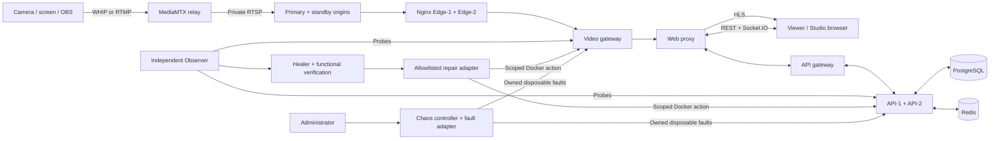

# StreamShield Live + Control

A live-streaming application with independently observed failures, bounded
self-healing and verified recovery. Creators broadcast from a browser or OBS;
viewers watch HLS video and chat; administrators inspect health, logs and actual
controlled failure experiments.

## Submission deliverables

- **[Resilience report — 5-page PDF](docs/StreamShield_Resilience_Report.pdf):**
  architecture diagram, detection/healing table, measured recovery times,
  before-and-after numbers, reproducible commands and known limits.
- **[Readable report](docs/RESILIENCE_REPORT.md)** and
  **[machine-readable report data](docs/RESILIENCE_REPORT_DATA.json)**.
- **[Runnable chaos script](scripts/chaos.mjs):** documented interactive and
  automated verification modes. [Actual experiment driver](scripts/four-scenario-live.mjs).
- **[Windows deployment guide](docs/WINDOWS_LOCAL_STUDIO.md)** and
  **[complete technical guide](docs/TECHNICAL_GUIDE.md)**.

The maintained branch is **`main`**. Earlier setup instructions are preserved in
[project history](docs/PROJECT_HISTORY.md); use this README for current commands.

## Architecture



The API carries application metadata and permissions. Video follows a separate
media path, so an API failure can leave video playing through healthy redundancy.
The Observer detects failures; the Healer performs allowed repairs; Chaos applies
faults and checks independent evidence. A Docker start receipt alone is not recovery.

**Stack:** TypeScript, Node.js 24, React 19, Vite, Express 5, Zod,
PostgreSQL 17, Redis 8, Socket.IO, MediaMTX, Nginx and Docker Compose.
Vitest/Testing Library/Supertest check policies and interfaces; Playwright checks
real browser playback and chat. The full optional telemetry topology adds
Prometheus and Grafana; the lightweight fixture omits them.

## Run locally on Windows

Prerequisites: Windows 10/11, Docker Desktop using Linux containers/WSL 2,
Node.js **24.x**, npm 11+, Git and a current Chrome/Edge browser. Docker's engine
must be running. The two deployments share host resources; an 8 GB PC has limited
headroom, and physical Windows performance is not certified by the Linux results.

```powershell
git clone --branch main https://github.com/Rashi-Bhojwani/StreamShield.git
cd StreamShield
npm.cmd ci
npm.cmd run setup:platform
npm.cmd run build
npx.cmd playwright install chromium
```

Prepare the demo runtime/images once; cached images can be reused:

```powershell
docker build -f infrastructure/healing/runtime.Dockerfile -t streamshield-healing-runtime:latest .
docker build -f infrastructure/healing/web.Dockerfile -t streamshield-healing-web:latest .
docker pull postgres:17.9-alpine
docker pull redis:8.6.2-alpine
docker pull bluenviron/mediamtx:1.21.2-ffmpeg
docker pull nginx:1.30.6-alpine
docker pull ghcr.io/shopify/toxiproxy:2.13.0
```

Setup preserves existing nonempty configuration and generates private local
credentials. `.env`, `.local/`, stream keys and database credentials stay private.
The detailed [Windows guide](docs/WINDOWS_LOCAL_STUDIO.md) covers OBS, ICE ports,
existing databases, troubleshooting and administrator access.

### Interactive streaming and failure controls

```powershell
npm.cmd run chaos -- --interactive
```

This is the same isolated interactive demo as `npm.cmd run demo:light`. It creates
a disposable `ss-light-<id>` project, a generated live sample and a signed-in
administrator browser. Wait for **READY** before clicking failure controls;
`browser-baseline-stable` can wait for a fresh 30-second healthy window.

1. Open the printed Control URL, normally `http://127.0.0.1:5174/control/chaos`.
2. Keep the generated sample running. For your own broadcast, open `/studio` on
   **5174**, create a livestream, preview camera/share screen, then Start Live.
3. Keep Studio open. Its chat receives audience comments and lets you reply.
   Open the exact watch link separately and verify moving video before a failure.
4. Select one failure, choose Run failure demonstration, acknowledge impact,
   type its exact target and submit Inject controlled failure.
5. Follow Failed → Recovering → Healthy and the retained verification timestamps.
   Wait for healthy readiness/cooldown before the next experiment.
6. Read understandable operational events at `/control/logs`.

Closing the demo browser, pressing Ctrl+C, or the approximately one-hour session
expiry cleans up its own fixture. Temporary accounts and broadcasts are discarded;
run artifacts remain under `test-results/`. Use one fixture at a time.

| Deployment                     | Address                 | Data and failure scope                                      |
| ------------------------------ | ----------------------- | ----------------------------------------------------------- |
| Persistent `streamshield-main` | `http://127.0.0.1:5173` | Persistent application accounts/database.                   |
| Disposable `ss-light-<id>`     | `http://127.0.0.1:5174` | Integrated streaming/failure demo; fresh accounts each run. |

The failure buttons on 5174 affect that disposable deployment. They do not kill
services belonging to the persistent application on 5173. To create a **new**
persistent base deployment, run `docker compose -p streamshield-main up -d --build --wait`
after setup. When reusing an existing database, preserve its matching `.env`
credentials; generating a different password does not change the stored password.

## Chaos script and failure behavior

```powershell
npm.cmd run chaos -- --help
npm.cmd run chaos -- --verify
```

`--help` starts nothing. `--verify` creates its own disposable fixture and actually
injects four sequential faults, checks independent recovery and decoded media,
and removes that fixture afterward. Stop an interactive demo before starting a
resource-heavy automated run. The script accepts no arbitrary host, project or
service target. It never targets `streamshield-main`.

| Control / typed target                       | Actual disruption                                                            | Restoration and evidence                                                                                                                                           |
| -------------------------------------------- | ---------------------------------------------------------------------------- | ------------------------------------------------------------------------------------------------------------------------------------------------------------------ |
| API crash / `api-1`                          | SIGKILL API-1; its requests/sockets can disconnect.                          | API-2 serves while the Healer starts API-1; readiness, catalog and gateway participation verify return. Video can continue.                                        |
| Video gateway / `video-gateway`              | SIGKILL the HLS entry gateway.                                               | Healer starts it; valid playlists/init/media and advancing segments through that gateway verify restoration. Buffered video may play before stalling.              |
| Edge failure / `edge-1`                      | SIGKILL Edge-1.                                                              | Delivery fails over to Edge-2 while Edge-1 is repaired and verified. Continuous playback is successful redundancy.                                                 |
| Network disruption / `demo-dependency`       | Toxiproxy delays the simulated read-only recommendation path for 20 seconds. | Owned delay cleanup plus circuit half-open/successful reads establish reconnection. Discover next changes; video is independent.                                   |
| Media authorization loss / `media-authority` | Both real video routes reject new requests; buffered video drains.           | Requires explicit operator reset, then advancing video verification. This safely simulates missing external signing authority; it is **not** automatically healed. |

The automatic script covers the first four. The fifth is checked separately by
`npm.cmd run test:system` against a running disposable demo; the Windows guide
provides the exact scoped test setup. No numerical recovery duration was recorded
in the earlier manual-failure evidence, so the report labels that duration unavailable.

### Authority and verification

- Administrator session, CSRF/origin checks, impact acknowledgement and typed target.
- Fresh observations, functional baseline, one active experiment and repair budgets.
- Project/service identity checks and allowlisted Docker actions; no public shell.
- Default two repair operations per service per ten minutes and a 30-second cooldown.
- Unknown/stale, escalated and unverified states remain explicit. No forced-green health.
- Browser retries, timed network cleanup, automatic repair and human intervention
  remain separate mechanisms in logs and evidence.

### Results and measurements

Automated results are saved to `test-results/light-four/measurements.json` and
`test-results/light-four/runs/<id>/`. Interactive results use `test-results/light-demo/`.
Reports contain timestamps, actual restoration duration, action receipts, observed
failover, playback samples and cleanup status; service logs are redacted.

The [five-page resilience report](docs/StreamShield_Resilience_Report.pdf) gives the
measured failure table and before/during/after figures. Its
[JSON data](docs/RESILIENCE_REPORT_DATA.json) records the source run and measurement
scope. Results are local experiments, not production recovery-time guarantees;
server restoration time is different from a viewer's buffering duration.

## Verify and reproduce

```powershell
npm.cmd run typecheck
npm.cmd run lint
npm.cmd run format:check
npm.cmd test
npm.cmd run build
```

`npm.cmd run test:studio` verifies synthetic-camera publishing, remote decoded
playback and creator/viewer chat against a running disposable demo. Linux checks
do not certify a physical Windows camera, firewall, VPN or 8 GB laptop.

To regenerate the PDF and readable report from the committed evidence:

```powershell
python -m pip install reportlab
python scripts/build-resilience-report.py
```

## Known limits

- One Docker host; redundant containers do not survive loss of that host.
- Singleton database, gateways, relay and Redis remain failure boundaries.
- Compact control services and API-2 share one trusted control-plane container.
- A server cannot recreate a missing camera, recover a lost key without backup,
  bypass external authority or create physical capacity through a restart.
- No verified 50,000-viewer capacity, production CDN/ABR pipeline or multi-region HA.
- Local HTTP/RTMP and loopback ICE are development defaults; public deployment
  needs TLS, public WebRTC/NAT design, secret management and off-host recovery.
- Missing playback-interruption measurements are **not** zero-second interruptions.

See the [technical guide](docs/TECHNICAL_GUIDE.md) for data models, APIs, security,
repair playbooks, lifecycle state machines and production work.

## Repository map

```text
apps/web/                       React Live, Studio, Watch and Control UI
services/api/src/platform/      Accounts, streams, auth, chat and media control
services/api/src/monitoring/    Independent probes, incidents, timelines and logs
services/api/src/healing/       Repair policy, restricted actions and verification
services/api/src/chaos/         Scenario registry, fault authority and experiment journal
packages/shared/               Shared types, validation and freshness rules
migrations/                    PostgreSQL schema history
scripts/chaos.mjs               Submission chaos-script entry point
scripts/four-scenario-live.mjs  Actual isolated experiment driver
infrastructure/                Container images and generated-topology entry points
docs/                          Report, technical guide, evidence and setup instructions
```
