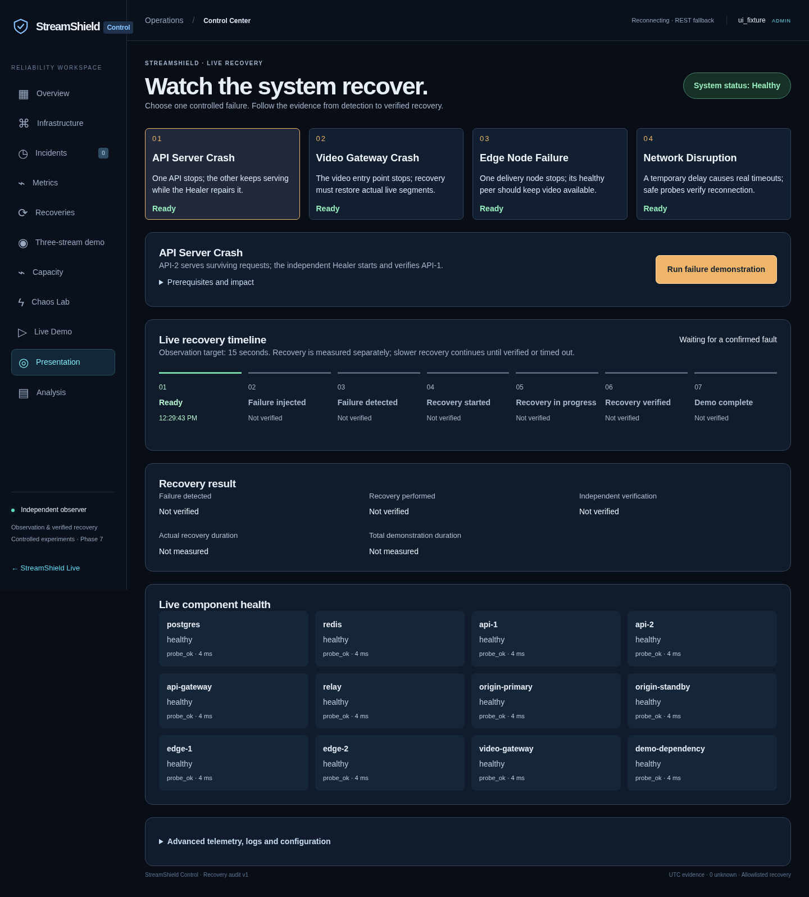

# Four-scenario repair: verified changes and remaining blockers

**Implementation delivered; full live acceptance is PARTIAL.** The UI, admission and recovery-state regressions are tested. A real Chromium run uses explicitly mocked REST responses and is UI evidence, not proof of infrastructure healing. Real isolated PostgreSQL/Observer/Toxiproxy checks pass. None of the four complete live scenarios passed in this run: Docker VFS exhausted available space during isolated startup; only the owned fixtures were removed. The Windows installation is not mounted here.

Baseline: `fb160d8` on `feature/final-self-healing-presentation`, initially clean. Existing `.env`, generated `.local` configuration and user database volumes were preserved. The user's later four-scenario request supersedes the previous five-scenario UI; historical results remain historical.

## 1. Confirmed causes and what remains unconfirmed

- **Correct route:** the browser calls `useAuth().call('/monitoring/chaos')`; `platformRequest` prefixes `/api/v1`, sending the signed-in cookie. The configured browser entry is **http://localhost:5173/api/v1/monitoring/chaos**. Generated web Nginx proxies `/api/` to `api-gateway:8080`; that gateway balances `api:4000` and `api-2:4000`. API-2 has no host port. API-1 normally publishes loopback 4000; a refused host-4000 connection alone does not establish what the gateway can reach. Check API-1 state and the actual resolved mapping. Configuration sources: `scripts/setup-healing.mjs`, `setup-resilience.mjs`, `setup-dynamic.mjs`, and `infrastructure/dynamic/compose.mjs`.
- **Windows evidence supplied:** API-2 is running/unhealthy, control containers report healthy, web responds, and host 4000 refuses connections. These facts do not establish the exact controller denial, PostgreSQL cause, OOM, or current API readiness response. Container liveness is not proof of Healer leadership, persistence or functional availability. No authenticated response or requested private controller/readiness output was supplied. The exact Windows denial therefore remains **unconfirmed**.
- **Timeout mismatch in the inspected generated configuration:** `DEPENDENCY_TIMEOUT_MS=5000`, API Docker health timeout 3s, Observer default HTTP timeout 1s. The previous `platform.ready()` awaited a normal pooled SQL request without a shorter readiness budget. That can outlast the health deadline. It is a confirmed configuration/code mismatch, not proof of the user's precise incident. `createReadiness` now performs real SQL and Redis checks with a 750ms default HTTP budget, coalesces callers, and refuses additional queued health queries while an old operation is still pending. Normal query/statement timeouts were not raised.
- **Missing observations:** `ChaosEngine.reason` previously accepted an empty component array as a healthy baseline. Admission now requires the expected critical identities, fresh observations, healthy peers and authorized repair budgets. Missing or unhealthy API-2 is an explicit denial when confirmed by the Observer.
- **Vacuous media verification:** `Verifier.verify` could accept `good === paths.length` when both were zero. Gateway/edge/origin recovery now requires actual live paths and segment progression. Media admission requires a genuine progressing source on primary and standby; a running gateway or HTTP 200 does not satisfy this.
- **Permanent terminal-state lock:** a failed/timed-out injected fault without the originally expected receipt could block future demos indefinitely, even after safe restoration. The controller now rechecks cleanup, current probes and representative behavior across two observations at least 2s apart, then durably records `BASELINE_REVERIFIED`. The old attempt stays FAILED/TIMED_OUT/CANCELLED with its original failure history. Merely changing a state, expiring a deadline, receiving a restart receipt, or rendering a green UI cannot unlock admission. Pending cleanup, active recovery, stale observations and audit failures still block it.
- **Idle load versus outage:** an explicitly measured zero request rate leaves the logical load signal UNKNOWN (`metrics_no_requests`). It is not counted as a failed physical service for non-load demos. Missing metrics or actual overload remain distinct; neither is silently converted to healthy zero.
- **Version mismatch:** new demo admission refuses an older backend that does not report the observation-window capability. Restart matching API/controller code and rebuild the frontend; do not bypass this check.
- **137 is not a diagnosis:** intentional SIGKILL faults and OOM can both yield 137. `OOMKilled`, health timing, dependency probes and logs must corroborate the cause. No current Windows OOM or checkpoint root cause is asserted.

## 2. Meaningful file changes

- Shared contracts: `packages/shared/src/operations.ts`, `chaos.ts`: exact four-ID catalog, observation capability, separate demonstration measurement, baseline-reverification event and idle-load classification; extended backend scenarios remain.
- Primary UI: `apps/web/src/control/Demonstration.tsx`, `demo-model.ts`, `demonstration.css`: four selectable cards, one run action, plain-language status/next step, seven evidence-based stages, real component health and final measurements. Cards remain visible but blocked on API/auth errors. Previous views are expandable Advanced diagnostics.
- `Chaos.tsx`, `Presentation.tsx`, `Control.tsx`, `useChaos.ts`, `chaos-readiness.ts`: same workflow on all three routes; polling, server-clock elapsed time, refresh recovery and version/readiness explanations. The original telemetry, stream player, history and topology remain available.
- `Confirmation.tsx`: existing exact-target, CSRF/authenticated, UUID-idempotent confirmation extracted for reuse; an immediate in-flight guard prevents duplicate submissions. Admission is refetched before POST.
- `services/api/src/chaos/config.ts`, `engine.ts`, `routes.ts`, `server.ts`: present/fresh critical baseline, measured network baseline/tolerance, continued behavioral checks, persisted observation window, separate durations, safe terminal reconciliation, and precise server admission reasons retained during a GET/POST race.
- `services/api/src/healing/verification.ts`: no zero-path media success; reusable actual component verification for safe terminal reconciliation, without fabricating a Healer action.
- `services/api/src/monitoring/observer.ts`: real zero-traffic observation stays UNKNOWN instead of global false outage/healthy metrics.
- `services/api/src/platform/readiness.ts`, `config.ts`, `routes.ts`: bounded/coalesced real readiness and recovery of probing after slow work settles. `infrastructure/chaos/repair-policy.yml` forwards the budget/window/tolerance without rewriting `.env`; `.env.example` documents defaults.
- `scripts/demo-diagnose.mjs`: read-only routing, actual container/OOM/health timing, per-API functional/dependency probes and private controller denial reasons. It never starts/restarts services or prints service credentials.
- `scripts/four-scenario-ui.mjs`: real Chromium rendering, responsive checks, REST fallback and lifecycle error states using mocked test data. `four-scenario-live.mjs`: isolated actual-service runner, existing images only, labelled fixture cleanup, no user/named volumes. VFS now requires at least 8GB free before starting; other drivers require 4GB. This resource check is conservative, not a capacity guarantee.
- Tests: readiness deadlines/coalescing/dependency errors, exact admission failures, stale terminal state, unsafe closure rejection, missing media, authentic timeline timestamps, duplicate clicks, browser refresh/polling and consistent four-choice UI. Existing extended Playwright suites now open Advanced diagnostics when exercising the previous views; they were not run end-to-end here.

## 3. Four-scenario verification table

| Primary scenario    | ID / confirmation                       | Real trigger and detection                                            | Recovery and required verification                                                                  | Complete live result / recovery duration                                                                         |
| ------------------- | --------------------------------------- | --------------------------------------------------------------------- | --------------------------------------------------------------------------------------------------- | ---------------------------------------------------------------------------------------------------------------- |
| API Server Crash    | `crash-api` / `api-1`                   | Restricted adapter kills API-1; independent readiness probes/incident | Independent `api-start`; direct readiness/catalog reads and serving evidence through gateway        | **BLOCKED by host storage** / not measured                                                                       |
| Video Gateway Crash | `crash-video-gateway` / `video-gateway` | Restricted gateway kill; independent HTTP/incident                    | `gateway-start`; actual authorized HLS segment progression through gateway                          | **BLOCKED by host storage** / not measured                                                                       |
| Edge Node Failure   | `crash-edge` / `edge-1`                 | Only Edge-1 killed; independent probes; surviving Edge-2 must stay up | `edge-start`; restored-edge segments; real surviving-edge routing must be observed                  | **BLOCKED by host storage** / not measured; no current fallback claim                                            |
| Network Disruption  | `network-timeout` / `demo-dependency`   | Owned Toxiproxy latency; real timeouts/circuit evidence               | Owned toxic removal, safe reconnection probes, CLOSED circuit and measured latency within tolerance | Complete lifecycle **BLOCKED by host storage** / not measured. Isolated real network mechanism passes separately |

Available means current operational prerequisites passed, not that a past test certified the installation. Missing source/peer/repair authority remains visibly blocked. No primary Redis, surge, database, broadcaster or all-edges failure is offered.

## 4. Observation and recovery timing

`CHAOS_OBSERVATION_WINDOW_MS` defaults to **15000**, range 5000–60000. It is stored with the admitted experiment so a restart/configuration change cannot shorten that experiment's window. It starts at confirmed injection time, not button click. The controller keeps making real behavioral checks through the window; no request handler sleeps to create an animation. If checks fail again, current verification is cleared. A successful demo also needs the complete healthy baseline restored. Slow recovery continues beyond 15s until verified or the existing deadline expires.

`measurements.restorationMs` measures actual stable functional recovery from injection; `measurements.demonstrationMs` measures the actual experiment duration. No four-scenario live duration is available from this run. Deterministic tests use shorter configured windows/fake clocks to establish this distinction; those values are not live measurements.

Network admission collects three actual successful safe reads. Restoration must fit `max(CHAOS_NETWORK_TOLERANCE_MS, 3 × maximum baseline sample)`, with a default absolute tolerance of 500ms. A fault that did not establish real detection is not successful. Cleanup is labelled separately from a Healer container repair.

## 5. Commands and actual evidence

See [raw measurements](FOUR_SCENARIO_MEASUREMENTS.json). Successful unit/UI/protocol checks are deliberately separated from blocked complete live scenarios.

| Final command                          | Exit | Actual result                                                       |
| -------------------------------------- | ---: | ------------------------------------------------------------------- |
| `npm run typecheck`                    |    0 | Root and workspaces pass                                            |
| `npm run lint`                         |    0 | Pass                                                                |
| `npm test`                             |    0 | **349 tests / 32 files pass**                                       |
| `npm run build`                        |    0 | Web/API build passes; existing large-chunk warning                  |
| `npm run test:four-ui`                 |    0 | **19 real Chromium UI checks**, mocked REST; not live healing       |
| `npm run test:repair`                  |    0 | Restricted-role real PostgreSQL/Observer/Toxiproxy mechanism checks |
| Both Compose `config --quiet` commands |    0 | Existing composition and policy layer validate                      |
| `npm run test:four-live`               |    2 | **BLOCKED**, insufficient VFS capacity; no scenario claim           |
| `npm run demo:diagnose`                |    0 | Read-only report; original stack absent here                        |

- `npm run typecheck`, `npm run lint`, `npm test`, `npm run build`, `npm run format:check`, both Compose `config --quiet`, and `git diff --check` are the required final checks.
- `npm run test:four-ui`: real Chromium with mocked REST; confirms exactly four cards/one action on all three pages, responsive 375/768/1440 layouts, no false injected/completed state, durable-ID refresh behavior, failed-history safety, stale/auth denial, and operation with WebSocket unavailable.
- `npm run test:repair`: real restricted-role PostgreSQL/Observer writes, advisory-lock backpressure, retained one-failure evidence, actual statement timeout/index plan, real Toxiproxy timeouts/circuit opening/expiry cleanup/closure. Three owned containers removed and original `.env` unchanged. It does not exercise complete API/gateway/edge Healer workflows.
- Initial `test:four-live`: failed during fixture startup. VFS disk reached about 29MB free. Fifteen specifically labelled fixture containers and their network were removed; no user volume was involved. The driver later reported its startup timeout; the measurements explicitly record the separate safety cleanup. Free space returned to about 4.9GB. No successful fault injection or recovery is claimed from that attempt.
- Final `npm run test:four-live`: exits **2 / BLOCKED** before creating containers because this VFS host lacks 8GB free. No repeated full startup was attempted.
- `npm run demo:diagnose`: read-only command executes here, reports the configured endpoint and missing original service containers. That is not a healthy-stack result or evidence about Windows.

### UI screenshots — mocked test data only

These screenshots show layout and state rendering, not observed production health/latency or live healing.



[Mobile](four-scenario-ui/mobile.png) · [Observation window](four-scenario-ui/observation.png) · [Failed recovery](four-scenario-ui/failed.png)

## 6. Safest Windows diagnosis first

Use your existing configured checkout and Docker Desktop Linux containers. Do not regenerate configuration or overwrite `.env`.

```powershell
Set-Location E:\StreamShield\StreamShield
node infrastructure/dynamic/compose.mjs ps -a api api-2 api-gateway web observer healer chaos-controller chaos-fault-adapter
curl.exe -i http://localhost:5173/api/v1/health/ready
npm.cmd run demo:diagnose
```

The diagnostic prints the actual controller's four readiness reasons from the trusted local terminal without exposing its token. Browser authentication remains required for `/api/v1/monitoring/*`. If using browser DevTools while signed in at localhost:5173:

```javascript
fetch("/api/v1/monitoring/chaos", { credentials: "same-origin" })
  .then(async (response) => ({
    status: response.status,
    body: await response.json(),
  }))
  .then(console.log);
```

A bare curl 401 means no administrator browser session; it is not proof of a controller outage. If API-2 returns 503, compare its direct SQL/PING and functional checks. If it times out while dependencies respond promptly, inspect CPU/event-loop/container health timing. If direct readiness is 200 but Docker remains unhealthy, compare recent health timestamps and wait for a fresh Docker result; do not manually mark it healthy. For a 137 exit, inspect `oomKilled` rather than guessing.

Read only the relevant logs: `node infrastructure/dynamic/compose.mjs logs --tail 100 api api-2 observer healer chaos-controller`. Keep unredacted logs private. `docker stats --no-stream streamshield-api-2-1` is a read-only resource sample for the container name supplied by the user. The exact Windows cause cannot be established without these current outputs.

## 7. Update and run without configuration regeneration

Use the authorized repair branch delivery. Stop on Git conflicts; preserve local edits, especially `services/api/src/chaos/config.ts`. No force/reset/stash-discard is required.

```powershell
Set-Location E:\StreamShield\StreamShield
git status --short --branch
git fetch origin feature/final-self-healing-presentation
git switch feature/final-self-healing-presentation
git pull --ff-only origin feature/final-self-healing-presentation
$before = (Get-FileHash .env -Algorithm SHA256).Hash
npm.cmd run typecheck
npm.cmd run lint
npm.cmd test
npm.cmd run build
node infrastructure/dynamic/compose.mjs config --quiet
node infrastructure/dynamic/compose.mjs build web
```

For an already running configured stack, apply only the changed services; database/cache/media containers and data volumes stay in place. First resolve any active experiment and inspect its result; do not use deployment as a way to hide a failed recovery.

```powershell
node infrastructure/dynamic/compose.mjs up -d --no-deps --no-build --force-recreate web api api-2 observer healer chaos-controller chaos-fault-adapter
npm.cmd run demo:diagnose
npm.cmd run final:status
npm.cmd run chaos:probe
npm.cmd run final:watch -- --once
(Get-FileHash .env -Algorithm SHA256).Hash -eq $before
```

For a stopped, previously configured stack with existing images: `node infrastructure/dynamic/compose.mjs up -d --no-build --wait`. This is not initial provisioning. Missing generated configuration/images is an explicit prerequisite; do not silently rerun setup or `final:up`, since they write configuration.

Open **http://localhost:5173/control/presentation**, `/control/demo` or `/control/chaos` as an administrator; refresh with Ctrl+F5. Keep the same localhost/127.0.0.1 origin throughout sign-in. Start a genuine source from Studio/OBS for media scenarios; the existing `npm.cmd run final:demo` is a bounded test-pattern publisher and creates a demo account. Keep it open.

1. Select API Server Crash, run, confirm `api-1`; observe actual injection, detection, Healer action, behavior verification and complete baseline.
2. After completion/cooldown, select Video Gateway Crash; confirm `video-gateway`. A progressing live source is mandatory.
3. Select Edge Node Failure; confirm `edge-1`. Keep Edge-2 up; inspect actual fallback and restored segments.
4. Select Network Disruption; confirm `demo-dependency`. Inspect measured baseline, timeouts/circuit, owned cleanup and within-tolerance recovery. No restart claim is made for expiry cleanup.

Do not advance when cleanup or recovery is unverified. Cancellation is available for an active observation and removes owned temporary faults; a crash still requires Healer or reviewed operator restoration. A timed-out/failed history entry only releases its safety lock after the new independent, persisted baseline verification. No journal erasure or manual green state is needed.

Automated tests: `npm.cmd test`. Optional UI fixture: install the matching existing Playwright browser using `npx.cmd playwright install chromium --only-shell`, then `npm.cmd run test:four-ui`. The isolated actual-service fixture is `npm.cmd run test:four-live`; it uses existing images only, temporary credentials/data and a unique project, and may refuse insufficient storage. Existing `npm.cmd run test:final` remains an extended, explicitly owned full-stack suite; it was not represented as passed here.

Stop the test-pattern publisher with Ctrl+C. Only when intentionally shutting down your demo use `npm.cmd run final:down`; never add `-v` or delete database volumes.

## 8. Delivery and remaining limits

The original architecture, additional backend scenarios, authentication, CSRF, role checks, typed targets, leases, budgets, cooldown and audit controls remain. The existing explicit approval authorizes normal commit/push delivery to the same feature branch; no force push or automatic merge. Final Git delivery is reported separately from live acceptance.

Remaining limits: no access to Windows; its exact controller denial and API-2 cause are unconfirmed; full four-scenario actual recovery/fallback/durations are unverified; the cloud's VFS capacity blocks the full fixture. These limits are not resolved by a successful build, mocked screenshots, container liveness or Git delivery.
