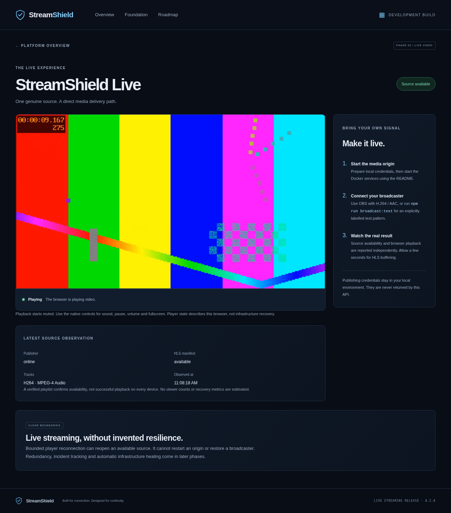

# Phase 2: Real Live Streaming Engine

## Scope and delivery

Phase 1 was inspected from disk, not inferred from a summary. Its 42 uncommitted files were preserved in initial commit `387cc57709f946b89362968b71430b79463f4a96`. The 22 original tests, type checks, lint, formatting, build and Compose validation passed before implementation. The original `docs/PHASE_1.md` remains a historical handoff.

The initial push was rejected with GitHub 403. After the user restored connected repository access, the Phase 1 commit was successfully pushed to remote `main`, fetched explicitly and confirmed as the feature branch's ancestor. All Phase 2 changes are isolated on `feature/phase-2-live-streaming`. No reset, force-push, discarded work or automatic PR merge is used. Final GitHub delivery is reported in the PR and chat handoff.

## What is implemented

- Official MediaMTX **1.21.2-ffmpeg**, pinned by release tag. RTMP ingestion, fMP4 HLS, a private authenticated Control API, a real HTTP health probe, restart policy and one configured development path. Unused RTSP, WebRTC, SRT, MoQ, playback server and metrics are disabled.
- Cross-platform Node bootstrap, random separate publish/control passwords, SHA256 hashes in ignored generated YAML, safe `.env.example`, preserved existing values, fail-closed template, path-scoped publishing and no anonymous/competing publishers. Reserved `any` and identical control/publish usernames are rejected. Non-development bootstrap is refused.
- Typed `/api/v1/streams` and `/api/v1/streams/:id`, with bounded/coalesced MediaMTX API and HLS observations. No video delivery through Express and no generic control or arbitrary-URL proxy. Unknown origin state is not invented as offline. API liveness/readiness remain independent of media availability.
- Homepage discovery and a responsive `/watch/:id` page. hls.js with native HLS fallback, muted startup, actual browser states, explicit autoplay blocking, real no-progress watchdog, bounded exponential retry, manual new-session retry, source-return reattachment and cleanup. Audio/fullscreen use native video controls.
- Bounded FFmpeg test-pattern/tone publishing via `npm run broadcast:test`; no credentials echoed in the helper's output. The test source is actual H.264/AAC video, explicitly described as synthetic.
- Unit/integration/browser tests, CI definition, Windows/VS Code/OBS instructions, current architecture, plan and official references. No Phase 3+ features were added.

## New files and major changes

| Area             | Files                                                                                                                                        |
| ---------------- | -------------------------------------------------------------------------------------------------------------------------------------------- |
| Player/discovery | `apps/web/src/streaming/Discovery.tsx`, `Watch.tsx`, `LivePlayer.tsx`, `LivePlayer.test.tsx`, explicit test fixture                          |
| Backend          | `services/api/src/media.ts`, `media.test.ts`, explicit test config; existing app/config/tests updated                                        |
| Media tooling    | `scripts/setup-media.mjs`, `media-env.mjs`, `media-env.test.mjs`, `test-publisher.mjs`, `media-integration.mjs`                              |
| Infrastructure   | `infrastructure/mediamtx/mediamtx.yml`, `infrastructure/docker/compose.local.yml`; standard Compose and Vite proxy extended                  |
| Contracts/config | Shared stream contract, API/browser validators, `.env.example`, ignores, root/workspace manifests and lockfile                               |
| Tests/docs       | `tests/e2e/media.spec.ts`, Playwright/Vitest/CI updates; README, architecture, roadmap, Phase 2 plan/references/handoff and real screenshots |

New dependencies are **hls.js 1.7.3** for actual browser HLS, **yaml** for maintainable runtime configuration rendering, and an explicit root Zod dependency for tooling validation (Zod was already used by application workspaces). Official references and compatibility decisions are listed in [PHASE_2_REFERENCES.md](PHASE_2_REFERENCES.md).

## Commands and evidence

All repository commands run from its root. In this Linux cloud, existing `/usr/bin/chromium` was selected with `PLAYWRIGHT_EXECUTABLE_PATH`; npm cache/Docker client configuration used writable directories outside the checkout. The optional proxy-aware build helper supplied existing proxy DNS and the platform CA without embedding credential values or disabling verification. None of the application/tooling code requires `/workspace/StreamShield`.

| Check                                                                                   | Result                                                                                                                                  |
| --------------------------------------------------------------------------------------- | --------------------------------------------------------------------------------------------------------------------------------------- |
| Initial Phase 1 `npm test`, types, lint, format, build and Compose config               | Passed; 22 original tests before changes                                                                                                |
| `npm install`, lockfile-based installation                                              | Dependencies installed with registry integrity/TLS verification                                                                         |
| `npm run setup:media` repeated with byte comparisons                                    | Idempotent, nonempty credentials/config preserved                                                                                       |
| Bootstrap with `NODE_ENV=production`                                                    | Rejected without modifying environment or runtime files                                                                                 |
| `docker compose run --rm --no-deps mediamtx --validate-conf=/config/mediamtx.yml`       | Official MediaMTX validation passed                                                                                                     |
| `docker compose config --quiet`                                                         | Valid configuration                                                                                                                     |
| `node infrastructure/docker/build-cloud.mjs` then `docker compose up --no-build --wait` | Development image built; API/web/MediaMTX healthy                                                                                       |
| Unauthenticated Control API request from API container                                  | HTTP 401; standard Compose does not publish the control port                                                                            |
| `npm test`                                                                              | Passed: 57 tests across 5 files, no skipped tests                                                                                       |
| `npm run typecheck`, `npm run lint`, `npm run format:check`, `npm run build`            | Passed, including root/tooling and workspace strict types; bundle-size warnings remain                                                  |
| `npm run test:e2e`                                                                      | Passed: 1 browser test, all assertions executed                                                                                         |
| `npm run test:media` with actual FFmpeg/Chromium/Docker                                 | Passed: H.264/AAC source, real HLS segment bytes, 97 decoded frames and advancing video time, source stop/return, origin outage/restart |

The integration suite rejects wrong publishing credentials, an unconfigured path and a competing publisher before accepting the valid source. It verifies media manifests/segments through the browser-facing proxy, waits for actual decoded video, then stops/restarts its own broadcaster. It also temporarily stops MediaMTX and confirms `unavailable` rather than offline while Express readiness remains 200. Restart is performed by the **test**, not by a healing controller. It leaves the publisher stopped and origin/application services running.

### Failures investigated

1. The generated YAML serializer initially emitted `rtmpEncryption: no` without quotes. MediaMTX's YAML handling interpreted `no` as boolean and rejected it. Strings are now quoted in generated YAML; official validation and startup pass.
2. MediaMTX's HLS cookie-check redirect initially prevented the metadata probe from verifying the playlist. The bounded probe now permits one same-origin/same-path redirect and rejects arbitrary destinations. Vite also rewrites `Location` under the configured media prefix, following the official subfolder documentation. A regression test covers allowed/forbidden redirects.
3. A first media run failed while the live API was being edited/restarted during diagnosis. This run was not counted as a passing media check. The stable corrected stack completed the real media suite afterward.
4. A player cleanup test counted a framework timer as a player leak; it now verifies the relevant behavior: destruction and no late source reattachment after unmount. A separate test ensures repeated waiting events do not postpone the no-progress deadline.
5. DOMException identification across the jsdom realm initially classified an autoplay denial as a load failure. Error-name handling now distinguishes blocked autoplay from codec/load failures; the regression test exercises it.

6. The portable publisher shutdown refinement accidentally applied IPC stdio to a synchronous Docker CLI call in the test runner. That call now uses ordinary ignored stdio; IPC is limited to test-owned Node publisher children. The affected media suite was rerun after correction.

## Host npm alternative verification

The documented `docker compose -f docker-compose.yml -f infrastructure/docker/compose.local.yml up -d --wait mediamtx` plus host `npm run dev` workflow was also exercised. A bounded test publisher produced live metadata, proxied HLS and **37 decoded Chromium frames**. The host processes were then stopped and the standard private-API Docker stack restored. Windows itself remains untested.

## Screenshots

These show **real decoded FFmpeg test-pattern video**, not a fabricated active stream or viewer metric. Screenshots are documentation assets, not build outputs.

[Mobile watch screenshot](images/phase-2-live-mobile.png)

## Limitations and Phase 3 handoff

- Physical OBS/webcam publishing, Windows Docker Desktop and Safari/native HLS were documented but not executed in this Linux environment. Native fallback and autoplay rejection have unit coverage; Chromium decoding has actual integration evidence.
- This is a single development origin with no video redundancy, CDN, accounts, chat, durable catalog, presence, incident storage, controller, chaos endpoints or capacity proof. The synthetic publisher is not a real audience/load test.
- HLS introduces buffering latency. A valid manifest is not proof of decoded playback; publisher, HLS and browser state remain separate. Probes must not be counted as viewer sessions in future analytics.
- Browser build chunks trigger size warnings. The player route is lazy-loaded, but bundle optimization remains future work. No build checks were disabled to hide the warning.
- Publishing and reading use local RTMP/HTTP. Production requires TLS/RTMPS, secure secret distribution/rotation, scoped authorization and production edge routing. Never expose the private control API or Docker socket.

Phase 3 should retain the current player/contracts/configuration and add authenticated viewer/broadcaster/admin roles, PostgreSQL-backed stream records, secure publishing authorization, Redis-supported presence/chat/rate limits and viewer sessions. It should preserve all real media regression checks. No healing or load-capacity claims follow from this phase.

## Reproduction

The exact portable commands, configuration inventory, OBS settings, bounded test broadcaster, local npm alternative and PowerShell walkthrough are in [README.md](../README.md). Use an idle local channel for `test:media`; never aim it at shared/production infrastructure.
