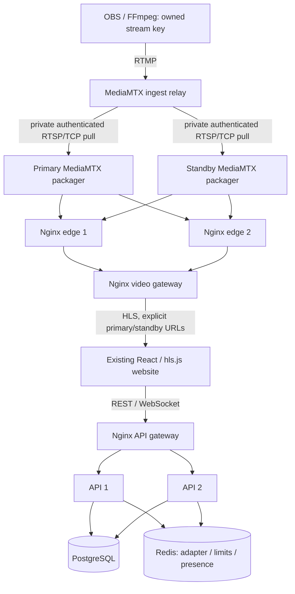

# Phase 4 — service redundancy and real media failover

## Baseline and delivery

Phase 3 was verified at 482a929 with 64 passing baseline tests, a clean worktree and open PR #4. PR #3 is also open. Phase 4 uses feature/phase-4-redundancy-failover stacked on feature/phase-3-streaming-platform. No dependency PR is merged, replayed or force-pushed. After the owner merges dependencies, fetch main, merge origin/main normally into this feature branch, resolve actual conflicts, rerun checks and retarget the PR. Preserve existing PostgreSQL volumes and all prior history.

## Actual optional topology

The existing lightweight docker-compose.yml stays the default. setup:resilience validates .env and generates a private overlay plus Nginx/MediaMTX configurations under ignored .local/resilience/. The portable wrapper always uses the base file plus this overlay. The redundant topology runs twelve long-lived services and a completed one-shot migration service on the existing private project network. Configured DNS aliases permit address changes without editing application source. Docker service roles are stable; stream paths remain dynamic database identities.

Only existing loopback ports are published: frontend 5173, compatibility API-1 4000, ingest RTMP 1935 and video gateway 8888. Browser application/API/socket/media access should use the frontend. No API-2, private auth listener, PostgreSQL, Redis, RTSP relay, origin HLS or origin administrative port is published. The direct loopback API compatibility port is not the browser load-balanced route.

## API balancing and failure semantics

Nginx 1.30.6-alpine uses round-robin upstreams, shared peer zones, Docker DNS re-resolution, configurable max_fails/fail_timeout and bounded connect/read/next-upstream deadlines. These are Open Source passive checks. Container health gates startup; no commercial active upstream health-check capability is claimed. Peers can be probed again after fail_timeout, so an occasional failed attempt is possible while a service remains down.

Public API routing never enables non_idempotent retries. A POST interrupted during failure can return 502/503/504; the client must inspect durable state before deciding whether to submit another operation. This is preferable to replaying an ambiguous stream creation or key rotation. Safe reads can retry surviving peers. The dedicated private media-auth POST is a side-effect-free authorization decision and explicitly permits bounded retry.

The gateway replaces incoming correlation IDs with its own random ID. APIs preserve only correctly formatted gateway IDs when TRUST_GATEWAY_IDS=true; the lightweight default still generates its own UUIDs. Forwarded headers are set by the gateway but are not trusted for identity, ownership, CSRF or arbitrary client IP authorization. Development requests share proxy admission limits; production trusted-proxy/per-client rate-limit design remains future work.

Each process logs a validated API_INSTANCE_ID. Private /internal/instance diagnostics require the existing service Basic credential and return instance readiness/socket IDs, never session/publishing secrets. They are not mounted on the public API. Tests prove public HTTP balancing by correlating request IDs against private instance logs. The operator probe accesses the private listener through Docker exec; no public diagnostic or container-management endpoint exists.

Each redundant API pool defaults to five connections, ten combined, leaving headroom in the development PostgreSQL service for migrations/tests/operators. Sessions and ownership stay in PostgreSQL. API shutdown retains the Phase 3 draining/deadline behavior. Tests use SIGKILL for abrupt loss and explicit Compose start for restoration; this is not a Phase 6 Healer.

## Distributed Socket.IO

The maintained Redis adapter, separate command/pub/sub clients, namespaces, durable PostgreSQL messages, CSRF/session checks and room isolation remain. Vite and Nginx forward WebSocket upgrades without buffering. The client intentionally uses WebSocket transport only, so HTTP long-polling sticky sessions are not claimed or required.

The integration runner identifies actual gateway-routed socket IDs on distinct APIs using private diagnostics, verifies cross-instance broadcasts, kills API-1, waits for the same authenticated viewer to reconnect through API-2 and checks durable catch-up. Acknowledged messages are checked for duplicate persistence. Redis Pub/Sub remains transient; disconnect-time delivery is not guaranteed, and history is the recovery mechanism. No automatic replay/exactly-once claim is made.

## Real replicated media

MediaMTX stays pinned to 1.21.2-ffmpeg. OBS/FFmpeg publishes once to the stable relay RTMP endpoint with its Phase 3 per-stream credential. Both origin packagers independently pull the matching path over private RTSP/TCP using supported regex capture substitution. Regex static sources require sourceOnDemand; the relay's publisher-lifetime runOnAvailable hook continuously warms both HLS paths with bounded requests. Both origins therefore receive genuine media while the publisher is available, and the hook reconnects a restored origin using the same configuration.

This hook supplies media and does not restart containers, manage PostgreSQL/Redis or perform general healing. A single relay remains an ingest single point of failure. If the relay or broadcaster disappears, both origins lose fresh supply. No standby can recreate missing camera video.

Relay RTMP publishing retains the exact owned stream path/key checks. Relay RTSP reads require a separate replication credential and current ready/owned stream authorization, or the explicitly enabled legacy development path. Origins have RTMP/RTSP publishing disabled and only pull configured authorized relay paths. Public clients cannot publish directly into a backup. Key rotation/end revoke first and disconnect the actual relay publisher; supply is removed from both origins. No raw publish key is persisted or exposed publicly.

Discovery first checks actual relay publisher evidence. A configured or reconnecting origin pull path is not proof of a broadcaster. Origin API/source availability and manifest evidence remain separate from actual browser decoding.

## HLS edges, caching and routing

Origins use ordinary fMP4 HLS, not low-latency HLS. Both real Nginx edges can serve either configured origin, with explicit primary/standby prefixes. Edges use MediaMTX's supported HLS CDN mode with a separate private HLS service secret. The edge injects this credential after discarding incoming Authorization/cookies; the secret never appears in viewer URLs or responses. This avoids per-viewer HLS session-cookie loss across proxies and makes public immutable segment caching appropriate.

Live/master/variant playlists always bypass caches and return no-store. Successful immutable MP4/M4S/TS objects use an origin-prefixed cache key, bounded TTL, inactivity and maximum disk size. Cache policy ignores upstream expiry headers so the configured bound applies. No stale fallback or error caching is enabled. Exact configured origins control CORS; origin media content types are retained. Tests retrieve actual playlists and media bytes and verify bypass/HIT behavior.

The video gateway load-balances edges and retries transport failures through the surviving edge. It does not mark healthy edges dead merely because an origin returned HTTP 502. An origin outage is handled by player source selection, not by mixing different origin segments under one playlist. DNS resolution updates recreated peers without incident-time config edits. Relative redirects are preserved safely; no internal hostname is emitted in viewer redirects.

## Player recovery and telemetry

Shared stream responses optionally include two public playback sources. The existing React player receives them in Watch, Home preview and Studio without changing the single-source default. It preserves its bounded retry/backoff/stall model and destroys old HLS state before initializing a different origin timeline. Source-list equality is based on content, so metadata polling does not repeatedly reattach playback.

The player tries standby after detected primary failure and stays there while it works, avoiding automatic failback flapping. Retry preferred playback source starts a new explicit session on primary after restoration. Assigning standby does not set Playing; actual browser media events and advancing decoded media still determine playback.

Typed observations add source_selected, source_failure_detected, alternate_source_selected, playback_reinitialized and recovery_failed, with a safe deliverySource role. Stream IDs, timings, stalls and errors remain available for Phase 5 integration; raw media URLs/credentials are not emitted. No monitoring dashboard/event store is introduced.

## Configuration and local operation

.env.example inventories all RESILIENCE_ settings: peer aliases, pinned image, listeners, DNS TTL, connection/response/socket deadlines, failure thresholds, upstream attempts, pool/worker limits, cache bounds, warming intervals, test/sample/stall limits and separate replication/HLS secrets. Setup preserves existing nonempty values and generates missing secrets without displaying them. Generated private files are mode 0600; do not commit or dump them. Existing app/session/publish secrets and schema stay intact.

The README contains the full Windows/VS Code workflow, normal registration/Studio/OBS instructions, FFmpeg broadcast, private probe, controlled crash/restore commands, complete test commands, troubleshooting and safe shutdown. Compose 2.24.4+ supports the explicit port-list override. Recommended optional-topology allocation is four CPUs and 6–8GB RAM; the lightweight default needs fewer resources. No application code requires a cloud-specific path or Docker socket.

## Experiment evidence and interpretation

Run npm run test:resilience only against this idle local development stack. It creates two disposable owners/streams, verifies warm origins and cross-path rejection, decodes distinct resolutions, checks HTTP balancing and cross-instance chat, injects API/edge/origin crashes, verifies recovery and captures screenshots. Timeouts are bounded. Cleanup restores selected services, stops only test-owned publishers and removes only known e2e_ accounts; no volume reset is used.

The generated test-results/phase4/measurements.json separates UTC injection times and monotonic elapsed durations. API traffic recovery is a successful authenticated response; chat recovery is verified reconnection/catch-up; playback recovery requires progressing decoded video; infrastructure restoration is an explicitly restarted service becoming ready/serving its expected stream. Restoration can include intentional time spent testing failover and must not be presented as autonomous recovery.

Playback sampling uses browser monotonic timestamps aligned to the runner, with configurable 250ms samples and a 1000ms stalled-progress threshold by default. Reported interruption is an observed decoded-progress gap at that precision, not an exact network-level outage. Both streams are independently checked. A null detection/recovery field means not observed/not applicable, never a fabricated zero. Source availability, routing availability and viewer decoding remain distinct.

Final measured runs, commands and limitations are recorded in the PR and the checked-in evidence below after verification. Failed implementation runs are not passes. Issues found included YAML 1.1 string quoting, configured pull paths appearing online, stale DNS addresses, relative HLS redirects/session handling and safe-write failure assumptions; each affected workflow must be rerun after correction.

## Remaining failure domains and Phase 5

This demonstrates redundant services on one Docker host, not host/region high availability or tested 50,000–60,000-viewer capacity. PostgreSQL, Redis, relay, gateways, frontend, Docker host and host networking remain single points of failure. Existing HLS can outlive an API/DB/Redis outage, but new ingest/pull authorization depends on the database/control route. Redis Pub/Sub cannot recover every transient delivery. Restarted origin timelines may cause a visible stall; latency and cooldown settings trade detection speed against retries/flapping.

Windows execution, physical OBS/webcam and Safari/native HLS still require manual platform validation. HTTP/RTMP development needs HTTPS/RTMPS, trusted proxies, secret operations, production resource budgets and storage/Redis redundancy before public hosting. Existing browser bundle/CI action advisories are not hidden.

Phase 5 should consume instance-tagged request/dependency logs, gateway upstream status/durations, per-origin publisher/manifest/fresh-segment observations, socket reconnect/delivery delays, approximate player-presence availability, typed source/playback events and sanitized JSON experiment records. It should define durable incident IDs, monotonic/UTC clock semantics, state transitions, measurement precision and retention. No dashboard, general incident controller, Healer or Chaos Panel is implemented here.

## Official references

See PHASE_4_PLAN.md plus the pinned MediaMTX HLS configuration/server implementation for hlsCDNSecret and CDN sessions: https://github.com/bluenviron/mediamtx/blob/v1.21.2/internal/servers/hls/http_server.go . Nginx OSS DNS-resolved upstreams, passive checks, idempotent retry semantics, cache headers and WebSocket handling were checked against current nginx.org documentation.

## Recorded local failure run

The complete extended test passed on 2026-10-19, including a new viewer joining during primary outage, preferred-source restoration, replication-aware key rotation, old-key rejection, fresh uncached playlists after republishing, owner end/revocation and ongoing independent playback. The sanitized original [measurement artifact](PHASE_4_MEASUREMENTS.json) is committed alongside actual [Watch screenshots](images/phase-4/).

| Injected failure | First detected           | Traffic recovery | Both players verified progressing | Chat recovery | Longest decoded-progress gap | Observed request errors         |
| ---------------- | ------------------------ | ---------------- | --------------------------------- | ------------- | ---------------------------- | ------------------------------- |
| API-1            | 0.972s (socket)          | 1.034s           | Continued; no >=1s sampled gap    | 3.618s        | 0.269s                       | 1 selected API read/write check |
| Edge-1           | No browser-visible error | 0.550s           | 1.491s                            | Not disrupted | 0.251s                       | 0 browser media errors          |
| Primary origin   | 2.108s (media request)   | 3.136s (standby) | 5.007s                            | Not disrupted | 1.250s                       | 5 browser media errors          |

A newly opened viewer decoded the surviving stream by 10.218s after primary injection. Both different-resolution streams remained isolated. The two players each had one thresholded progress gap during origin switching; playbackInterruptionMs sums those two observed gaps (2.500s aggregate), not one viewer's exact pause duration. Sample precision is 250ms and the threshold is 1000ms. Gateway retries can hide edge transport errors from the browser, so its browser-detection field is null rather than invented.

Infrastructure became ready again 7.129s / 3.125s / 14.563s after the respective API/edge/origin injections. These totals include time deliberately spent verifying surviving traffic before the test explicitly restarted each service. They are not automatic container-healing times. Routing and source failover happened while the failed services were stopped and without configuration edits. A separate fresh-manifest/segment check through the actual primary route preceded explicit player failback.

This is a measured local prototype run, not an availability/recovery SLO or a zero-downtime claim. Other development runs observed an unsafe write fail with 504; the test verified absence in durable state before explicitly resubmitting and checked that persistence was not duplicated. First-pass API reads can also fail during passive detection. Every failed development run remained a failure until corrected and rerun.

## Final local verification

- Locked installation and rebuilt-image Docker startup passed. Both the lightweight and optional redundant Compose configurations validated and started with real health checks; the migration gate completed and PostgreSQL data was preserved.
- npm run typecheck, npm run lint, npm run format:check, npm run build and git diff --check passed. Existing bundle-size advisories remain.
- npm test: **71 tests / eight files passed**, preserving all 64 baseline checks and adding source selection, input/timeout/alias boundaries, credential redaction and origin-evidence regressions.
- npm run test:platform: **22 named real PostgreSQL/Redis checks passed** on isolated migrated data.
- npm run test:e2e: **ten browser tests passed on each topology**, including real accounts, Studio, channel/profile persistence, chat and responsive navigation.
- npm run test:media: retained actual RTMP/HLS regression passed with **111 decoded frames**, two viewers, source stop/return and origin outage.
- npm run test:media:platform: retained two-owner/two-source test passed, including key rotation/end, actual presence/chat, PostgreSQL restart persistence and continuing HLS through DB/Redis outages.
- npm run test:resilience: the complete controlled API/socket/edge/origin failure test passed with two decoded streams, cold-viewer admission during outage, safe write semantics, fresh routed restoration, replication-aware rotation/revocation, fresh republished playlists and independent survivor playback. The representative measured run is committed above.
- Actual screenshots at 375/768/1280/1440/1920px were inspected; the full-width consumer layout and usable chat remain. Generated configuration/credential scans found no matches in candidate Git files.

CI runs lightweight and redundancy checks independently on clean runners. Actual remote results belong to the PR checks; no remote success is inferred from these local runs. Physical OBS, Windows execution, Safari, host/region failure and audience load remain unverified.
