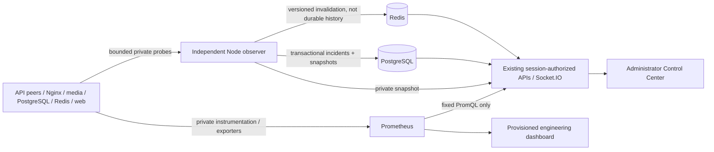

# Phase 5: Observability and StreamShield Control

Phase 5 adds independent monitoring to the optional Phase 4 deployment. Live video, authentication, owned channels, chat and source failover retain their existing data paths. The React Control Center is available at /control only to server-authorized administrators. This phase performs observation, diagnosis and verification; restoration is still an explicit operator/test command.

## Architecture and deployment



The monitoring composition layers docker-compose.yml, .local/resilience/compose.yml and .local/monitoring/compose.yml. There are 21 long-lived services and two migration/bootstrap jobs. Fourteen components are inventoried: web, API gateway, two APIs, PostgreSQL, Redis, video gateway, two edges, relay, two origins, Prometheus and Grafana. Observer self-health and persistence are reported separately. Fifteen containers have functional Docker health checks; six exporters are verified by actual Prometheus scrapes, rather than a running-process claim.

Pinned images: Prometheus 3.15.0, Grafana 13.2.4, Nginx exporter 1.5.3, postgres_exporter 0.20.1, redis_exporter 1.94.0; inherited MediaMTX 1.21.2, PostgreSQL 17.9, Redis 8.6.2 and Nginx 1.30.6 remain. API instrumentation uses maintained official @prometheus-io/client 0.16.1. The deprecated prom-client package was removed during dependency research.

## Windows VS Code setup

Use Git, VS Code, Node.js 24, Docker Desktop with Linux containers and Compose 2.24.4+, Chrome, FFmpeg/libx264/AAC and optionally OBS. Allocate about four CPUs, 8GB Docker RAM and at least 20GB free Docker disk for ordinary layered storage. Docker VFS can require substantially more disk.

For an existing checkout, first preserve your own uncommitted changes and run the fetch/switch commands. For a new checkout:

```powershell
git clone https://github.com/Rashi-Bhojwani/StreamShield.git
cd StreamShield
git fetch origin
git switch --track origin/feature/phase-5-observability-control-center
code .
npm.cmd ci
if (!(Test-Path .env)) { Copy-Item .env.example .env }
npm.cmd run setup:monitoring
node infrastructure/monitoring/compose.mjs config --quiet
npm.cmd run monitoring:up
npm.cmd run monitoring:status
npm.cmd run monitoring:probe
npm.cmd run resilience:probe
```

Start Docker Desktop before Compose. setup:monitoring preserves nonempty .env values, adds missing configuration and credentials, then renders private configs. The standard up command builds from the lockfile, applies forward migrations and bootstraps restricted monitoring database identities. PostgreSQL accounts, channels, chat, incidents, Grafana and Prometheus named volumes survive shutdown. Never use down -v for this workflow.

Open http://localhost:5173 for Live. Register a normal account through /signup. Grant only your intended account administrative access from the trusted local terminal:

```powershell
node infrastructure/monitoring/compose.mjs exec -T api-2 node scripts/set-role.mjs YOUR_USERNAME administrator
```

Reload the browser session and open http://localhost:5173/control. Registration cannot grant administrator rights. Ordinary users receive HTTP 403 for monitoring APIs and cannot join monitoring rooms; anonymous users must sign in. Removing the role takes effect on subsequent API requests and monitoring delivery.

Open http://localhost:3000 for Grafana (OBS_GRAFANA_PORT). Sign in as operator using the generated OBS_GRAFANA_PASSWORD from your private local .env. Do not share it or capture it in screenshots. Provisioning installs the StreamShield Prometheus data source and Infrastructure & Media dashboard without manual creation. Anonymous access/signup and optional plugin preinstallation/update checks are disabled. Existing Grafana-volume credentials are not reset by changing an environment variable; use Grafana's authenticated account settings for rotation.

Prometheus has no published host port. Inspect its actual targets through the private network or use Grafana; do not expose its unrestricted query API publicly.

## OBS and FFmpeg

For your owned broadcast, create a channel and livestream in Studio, then create its publishing credential. OBS → Settings → Stream → Custom: copy the exact Server and Stream Key supplied by Studio. The default RTMP server is rtmp://127.0.0.1:1935. Use H.264/yuv420p, AAC and two-second keyframes. Open the owned Watch URL in Chrome. Media is carried by relay → origins → edges, not Express.

For the bounded legacy development test channel:

```powershell
npm.cmd run broadcast:test
```

Open http://localhost:5173/watch/live. The default publisher stops after 120 seconds. This is synthetic FFmpeg video, not a webcam. The observer verifies publisher presence, HLS manifests, actual latest-segment bytes and segment-identity progression independently on both origins. Idle is not a service failure. Only five active relay paths are sampled per media cycle; this is not complete large-catalog coverage. Each response is bounded to 2MiB; oversized media responses cannot be verified by this lightweight probe.

## A bounded real outage demonstration

With Control open (and optionally a broadcaster running):

```powershell
npm.cmd run monitoring:control -- crash api
# Keep the service stopped long enough for two failed observations.
# Inspect API-1, the incident timeline and surviving API-2.
npm.cmd run monitoring:control -- restore api
```

The commands reuse Phase 4's loopback-only CLI whitelist (api, edge-1, origin-primary). monitoring:control retains the monitoring composition during restoration. The monitoring service itself never injects faults or executes restoration. Do not use the resilience-only restore command while running the monitoring composition because its overlay differs.

Inspect /control/incidents, filter API-1, open its incident, and inspect first failure, confirmed detection, first successful probe, verification and resolution. Initial and repeated probes must not create duplicate active incidents. A confirmed recurrence after resolution creates a new incident. API redundancy can keep requests operational while API-1 is red; this is degraded redundancy, not necessarily a complete application outage.

## Health and timing semantics

- HEALTHY: configured successful probe threshold reached.
- DEGRADED: first failed observation after healthy state, or confirmed dependency/readiness failure with a responding API. Suspicion alone does not create an incident.
- UNHEALTHY: consecutive failed availability probes meet the configured failure threshold.
- UNKNOWN: insufficient warm-up evidence, rejected/invalid probe responses, stale observer data or unavailable monitoring. Unknown never verifies recovery.
- RECOVERING: first successful observation after an outage while further verification is pending. It does not mean an automated action ran.

Defaults: 2s non-overlapping service cycle, up to 200ms positive jitter, 1s probe deadline, four workers, two failures and two successes. Slow components do not block other worker slots; full-cycle latency can grow when many targets fail. A separate 10s media loop never delays service probes or incident persistence. Media freshness requires an observed segment-identity change, then expires after three media intervals. It is distinct from browser decoding.

The observer starts with UNKNOWN and requires success evidence. Confirmed outage records require at least two probes, including at startup. Coordinated startup/shutdown can create real incidents when services remain unavailable beyond the threshold. For planned maintenance stop observer first, then the remaining stack; there is no maintenance-suppression scheduler yet.

Console date formatting follows the browser locale; JSON evidence is UTC. Persistent UTC timestamps order events; monotonic clocks measure confirmation delay within the observer process. Time to detect starts at the first failed observation, not an unknown physical failure time. The test harness separately records its injection UTC and monotonic elapsed time. UTC durations spanning restart/process boundaries assume synchronized clocks and cannot promise precision beyond polling. duration_ms measures the window from first failed observation to first successful response; verification/resolution occurs later. Gaps in evidence do not prove continuous unavailability. Negative/invalid wall-clock durations remain unmeasured rather than becoming fabricated zeroes. Infrastructure probes never claim routed request, source failover or browser playback recovery.

## Incidents and persistence

Migration 1761100000000_observability.js adds monitoring_state, monitoring_components, monitoring_incidents and monitoring_incident_events. Existing tables/data remain intact. A transactional advisory lock serializes writes; a partial unique index permits one active component/failure identity. Persisted states progress DETECTED → DIAGNOSED → SERVICE_RESTORED → RECOVERY_VERIFIED → RESOLVED. DETECTED and DIAGNOSED may occur in one transaction. Diagnosis identifies the failed availability signal; it does not invent root cause. No ACTION_TAKEN event is emitted.

Successful recovery requires consecutive component probes and increments verified-restoration counts through persisted evidence. Failure during verification returns the same incident to diagnosis. The observer reconciles stored components/unresolved incidents after restart. Unknown observations do not resolve incidents. Incident details include evidence, UTC timestamps, duration, source and correlation identity; the current correlation ID groups that incident's own events, not inferred causal relationships between different failures.

During PostgreSQL outage, probes continue in memory and persistence explicitly fails. A bounded latest confirmed episode per configured component is retained and reconciled after the database returns, including its original confirmation timestamp and delayed-persistence evidence. This is not a durable local journal: simultaneous observer loss can lose evidence that PostgreSQL never accepted, and multiple recurrences while persistence is unavailable can coalesce. No saved-incident claim is made during that interval. Redis outages do not erase PostgreSQL incidents; sockets fall back to snapshots after reconnection.

Resolved incidents/events are retained 90 days by default, deleting at most 100 eligible resolved incidents per cycle. Open incidents are never pruned. Recovery counts cover retained verified incidents, not lifetime accounting. Incident lists use bounded filters, 20-row pages and newest/oldest sorting; each detail currently returns up to 100 timeline events.

## Metrics coverage

| Source                             | Actual collected signals                                                                                                                        | Limits                                                                                                                                                                    |
| ---------------------------------- | ----------------------------------------------------------------------------------------------------------------------------------------------- | ------------------------------------------------------------------------------------------------------------------------------------------------------------------------- |
| API private /metrics               | Normalized-route request/category counters; duration histogram; in-flight requests; process RSS/CPU; event loop/GC; local Socket.IO connections | Queries include health traffic. No user/path/key labels.                                                                                                                  |
| Nginx stub_status + four exporters | Connections, accepts, handled requests, reading/writing/waiting                                                                                 | OSS stub_status provides no status-code, upstream-error or cache-hit distributions. Safe request logs remain available separately.                                        |
| MediaMTX private metrics           | Paths/source state, RTMP connections/traffic, muxer/transport bytes                                                                             | Ephemeral media path/connection labels retained only for selected families; 2,000 samples per target cap ingestion. Not audience analytics.                               |
| Redis exporter                     | Availability, memory, clients, command statistics                                                                                               | Private authenticated Redis; no public exporter.                                                                                                                          |
| PostgreSQL exporter                | Availability, connections, transaction/database statistics                                                                                      | Separate pg_monitor identity; no app-table grants.                                                                                                                        |
| Observer                           | Process metrics, thresholded fixed-component availability, persistence availability                                                             | Observer self-health does not prove DB durability.                                                                                                                        |
| Browser reports                    | Expiring approximate advancing owned-player reports and selected primary/standby source                                                         | Existing visible/unpaused media progress heartbeat; client-reported, can be forged, not global viewers. Legacy compatibility player has no owned chat/presence heartbeat. |

API metrics are authenticated on the existing unexposed private listener. MediaMTX metrics use separate private control-plane permissions; no metrics/admin host ports are published. Nginx status listens only on Docker networking. Prometheus scrapes every 5s with a 3s deadline; default retention is 7 days and 512MiB. Query concurrency/time and exporter/observer/Grafana memory are bounded. monitoring:probe verifies all fourteen current component observations and twelve actual scrape targets with a bounded readiness window. React uses only nine fixed PromQL summaries over ten minutes with ten-second sample steps; untrusted clients cannot submit arbitrary PromQL.

No host/cgroup collector is deployed: collecting host/container CPU/RAM securely requires additional scoped access. Process resources shown by this phase cover Node APIs. Missing metrics remain empty/unavailable. No generated curves, committed experiment values or fake green nodes are used as telemetry.

## REST, realtime and UI

All routes below require a current administrator session and share a 120/minute per-account Redis rate limit. During Redis loss, read-only monitoring uses a bounded 100-administrator process-local fallback (120/minute per instance); fresh PostgreSQL authorization remains mandatory. No write/publishing permission bypass is introduced:

- GET /api/v1/monitoring/snapshot — authoritative observer state, durable incident summary, media and approximate browser signals. Observer failure falls back to durable history with stale=true.
- GET /api/v1/monitoring/incidents — validated severity/component/status/order/offset filters.
- GET /api/v1/monitoring/incidents/:id — durable evidence/timeline.
- GET /api/v1/monitoring/metrics — coalesced fixed PromQL results cached for ten seconds; arbitrary query parameters rejected.

Existing Socket.IO handshake still checks exact Origin/CSRF/session. monitoring:subscribe rechecks the administrator role; monitoring:v1 carries `{version:1, sequence, at, kind:"snapshot_changed"}`. APIs revalidate authorization before each local delivery and never broadcast to public rooms. The envelope is an invalidation hint, not an event journal. Clients fetch snapshots on connect/reconnect, invalidation and periodic reconciliation, so missed Pub/Sub events do not silently become authoritative state.

The separate full-width /control shell contains overview, /control/topology, /control/metrics, /control/incidents, /control/incidents/:id and /control/services/:id. Cards/nodes are keyboard links; colors have textual states. Dependency arrows list real configured links. The UI computes staleness locally every second as well as from server state; after OBS_STALE_MS all component states become UNKNOWN, including previously healthy cards. Disconnected sockets, rejected authorization and unavailable storage/metrics are visible. Operational data is never returned to ordinary Live users.

Phase 4's checked-in [historical measurement file](PHASE_4_MEASUREMENTS.json) remains explicitly historical test evidence. It is not automatically imported as current incidents or live graph data. Future experiment imports must be explicit, validated and provenance-labelled.

## Configuration and repeatability

.env.example lists OBS_INTERVAL_MS, OBS_TIMEOUT_MS, OBS_FAILURES, OBS_SUCCESSES, OBS_CONCURRENCY, OBS_STALE_MS, OBS_MEDIA_INTERVAL_MS, OBS_RETENTION_DAYS, OBS_PORT, OBS_METRICS_PORT, OBS_NGINX_STATUS_PORT, OBS_GRAFANA_PORT and OBS_PROMETHEUS_RETENTION. Separate generated OBS_SECRET, OBS_GRAFANA_PASSWORD, OBS_PG_PASSWORD and OBS_DB_PASSWORD remain private. Ports, cycle/staleness budgets, thresholds, concurrency and retention are validated. Metrics queries/range and room/message contracts are deliberately fixed and bounded.

Generated .local/monitoring is mode 0700; mounted files inside are 0644 so non-root service UIDs can read them. The parent protects secrets on the host. The observer receives only an individual inventory-file mount, so differing host/container UIDs cannot block traversal and unrelated Grafana/exporter credential files are not mounted into it. Do not expose/mount the directory to web assets. The observer receives no session/CSRF or publishing credentials; its PostgreSQL identity has rights only on monitoring tables/sequences. Prometheus/Grafana/exporters use no-new-privileges and dropped Linux capabilities. No Docker socket is mounted.

After .env edits, rerun setup:monitoring and recreate/restart affected services to reload configurations. Setup preserves credentials; PostgreSQL role grants are applied idempotently by the bootstrap job. To switch back to lightweight mode, stop monitoring without -v, run setup:platform, then docker compose up --build --wait. To return, rerun setup:monitoring and monitoring:up. Avoid starting different overlays concurrently on the same project/ports.

## Verification commands

Stop your own broadcaster before fault tests; they create and clean only their test-owned resources:

```powershell
npx.cmd playwright install chromium
npm.cmd run typecheck
npm.cmd run lint
npm.cmd run format:check
npm.cmd test
npm.cmd run build
npm.cmd run test:monitoring
npm.cmd run test:resilience:monitoring
```

The monitoring test verifies administrator boundaries, actual scrapes/Grafana provisioning, real FFmpeg/HLS decoding, API/edge/origin outages, incident deduplication/recurrence/restoration, observer restart, staleness, Socket.IO reconnection, DB/Redis observations and responsive screenshots. It restores only explicitly stopped services and preserves named volumes. Results are generated under test-results/phase5. The retained Phase 1–3 regressions are run in the lightweight composition:

```powershell
npm.cmd run monitoring:down
npm.cmd run setup:platform
docker compose up --build --wait
npm.cmd run test:platform
npm.cmd run test:e2e
npm.cmd run test:media
npm.cmd run test:media:platform
```

To finish, stop OBS/FFmpeg and use npm.cmd run monitoring:down (or docker compose down in lightweight mode), without -v. Monitoring shutdown may itself leave open observations while dependencies stop; next startup reconciles them rather than erasing evidence.

## Troubleshooting

- Start Docker Desktop in Linux-container mode; check docker version / docker compose version and monitoring:status. Resolve 5173/4000/1935/8888/3000 port conflicts before startup. Regenerate configs after changing ports/origins. Windows npm.cmd avoids PowerShell execution-policy blocks.
- Account appears denied: promote the intended existing username through the trusted CLI, reload auth, verify a current session. Database/Redis unavailability can deny authorization; no bypass is provided.
- Stale gray services: inspect observer logs and health, then PostgreSQL/bootstrap; no browser can replace the independent observer. Never dump .env, generated private configs or resolved Compose output.
- No charts: wait for two scrapes/rate samples; inspect actual Prometheus target availability. Empty/error-rate data is not fabricated as zero. Grafana provisioning requires readable mounted files and its bundled Prometheus plugin; optional online plugin installation is unnecessary.
- RTMP failure: use the exact Studio-owned path/key, ensure the previous publisher disconnected, H.264/AAC and matching ports. Rotate a lost key; it cannot be retrieved from storage. Windows firewall/OBS encoder configuration requires local validation.
- HLS unavailable: inspect publisher, origins, manifests, fresh segment probes and browser decoding separately. Existing video can continue while API auth is unavailable. A restored process is not proof of a fresh media timeline.
- VFS cloud disk: normal Docker Desktop does not require this workaround. After a trusted image pull/build, infrastructure/docker/flatten-image.mjs can flatten its filesystem while preserving public image configuration on VFS only. It never copies container runtime credentials. Old running images are retained until no longer referenced. Builder caches may need explicit cleanup; never prune volumes.

## Official references researched

- https://github.com/prometheus/prometheus/blob/v3.15.0/docs/configuration/configuration.md — scraping, authorization and limits (website returned 403; official repository used).
- https://grafana.com/docs/grafana/latest/administration/provisioning/ — data sources and file dashboards.
- https://github.com/bluenviron/mediamtx/blob/v1.21.2/docs/2-features/22-metrics.md and mediamtx.yml — actual metric families and metrics permissions (website returned 403).
- https://nginx.org/en/docs/http/ngx_http_stub_status_module.html and https://github.com/nginx/nginx-prometheus-exporter — supported Nginx fields.
- https://github.com/prometheus/client_js — maintained Node collector and histograms.
- https://github.com/prometheus-community/postgres_exporter/tree/v0.20.1 — pinned release environment configuration and pg_monitor (unreleased main flags differed and were not used).
- https://github.com/oliver006/redis_exporter — Redis authentication/metrics.
- https://socket.io/docs/v4/server-api/ — authenticated rooms, connection/disconnection.

## Remaining boundaries and Phase 6

Single Docker host, PostgreSQL, Redis, relay, gateways/frontend and observer remain failure domains. Prometheus/Grafana are single instances. This is polling-based local service observability, not host/region HA, complete distributed tracing, an SLO or demonstrated 50,000-viewer capacity. Windows execution, physical OBS/webcam and Safari native HLS require separate manual validation.

Phase 6 can consume stable component IDs, version-1 snapshot/invalidation contracts and durable incident IDs/events. Future actions need a separate controller lifecycle, narrow service authority, auditable action rows, idempotency, timeout/retry/cooldown budgets and explicit user-facing verification. A diagnostic event is not action authorization. Phase 5 has no general container-management HTTP API, autonomous restart or interactive chaos panel. Phase 7 experiments must record injection separately and keep historical test results separate from live incident evidence.

## Recorded verification

The final local run passed 98 unit tests / eleven files, typecheck, ESLint, build (including the observer bundle), frozen npm installation and Docker image build/startup. Runtime audit: zero reported advisories. The isolated platform suite passed 22 named checks with both exact migration names, and the retained browser suite passed all ten tests. The original media test decoded 107 frames and verified two concurrent viewers/source interruption. The two-owner media suite passed rotation/end, chat/presence, actual decoding and continuing HLS through Redis/PostgreSQL outages and durable database restart.

The full monitoring integration passed twice, including actual FFmpeg video, all twelve Prometheus targets, Grafana provisioning, administrator HTTP/socket boundaries, API/edge/origin incidents, restart reconciliation, delayed persistence, staleness/reconnect and recurrence. The provisioned Grafana data-source health API returned HTTP 200/OK after querying Prometheus. The observer's application-table query was rejected with PostgreSQL 42501, verifying restricted grants.

The retained Phase 4 failure suite also passed against the monitoring composition with two owned decoded streams, cross-instance chat/session continuity, edge routing, fresh primary/standby delivery, cold-viewer admission during primary outage, key rotation/revocation and safe-write semantics. One measured run recovered API traffic by 0.521s, edge traffic by 0.477s and both standby-decoded streams by 5.043s; these are independent harness measurements, not observer confirmation delays or autonomous recovery times. Three browser media errors and a 1.254s maximum sampled decoded-progress gap were observed during origin switching; zero-interruption is not claimed.

The committed [Phase 5 measurement artifact](PHASE_5_MEASUREMENTS.json) records one successful monitoring run. Observer confirmation followed injection by 2.397s / 3.475s / 4.107s for API-1 / edge-1 / primary origin using UTC wall-clock differences; the harness first read the confirmed state by 2.565s / 3.836s / 4.368s. Confirmation delay after first failed probe was 2.052s / 1.982s / 2.021s using monotonic clocks. Observed unavailability windows were 14.353s / 3.985s / 4.118s; these include deliberate test delays and explicit restoration, especially the observer-restart check during API outage. Eleven transient snapshot read failures were recorded and retried as bounded reads. Browser decoded progress was independently asserted after each outage; this suite does not fabricate a playback-recovery duration.

[Actual screenshots](images/phase-5/) cover 375/768/1280/1440/1920px, a red API-1 with a durable open incident and both fresh media sources, and a resolved incident's evidence timeline. All widths were inspected for overflow, readable cards, functional navigation and truthful UNKNOWN states during warm-up. Screenshot values are captured observations, never seeded display metrics.

Development failures were corrected and affected checks rerun: Docker VFS disk exhaustion, a transient registry connection reset, pinned-exporter configuration differences, non-root Grafana dashboard readability, a restricted sequence grant, Vite private-host validation, missing media probe configuration, cold browser launch/setup, a filter label and a one-migration historical assertion. An installation/Playwright overlap was rerun after dependencies stabilized. No failing/interrupted run is counted as a pass. Existing bundle-size and action-runtime advisories remain visible. Windows, physical OBS and Safari were not executed on this Linux cloud host; GitHub CI status belongs to actual PR checks and is reported separately.
