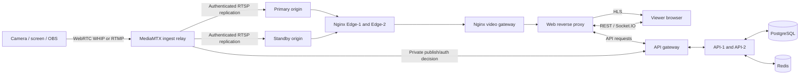
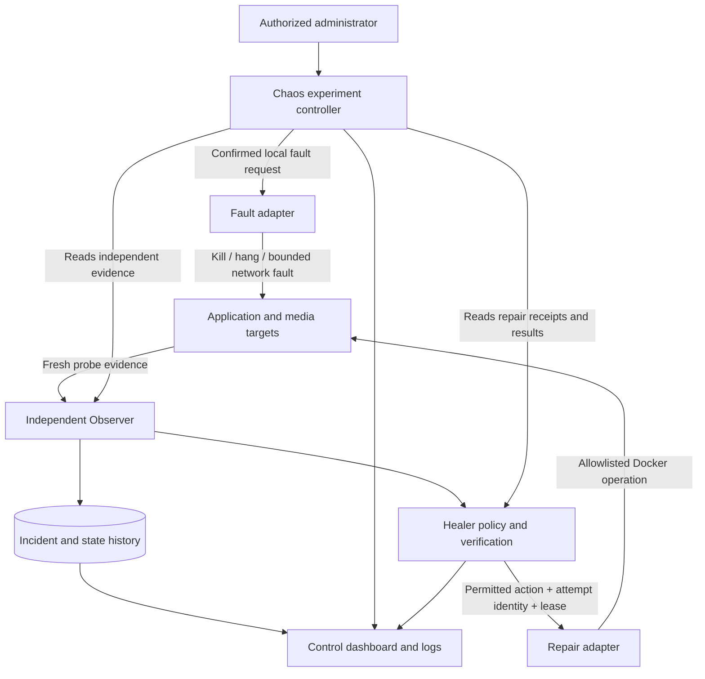
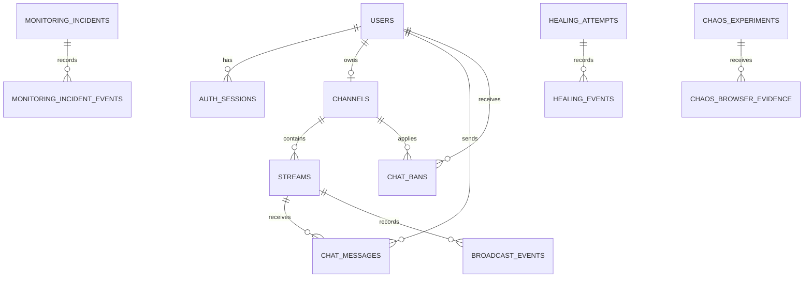
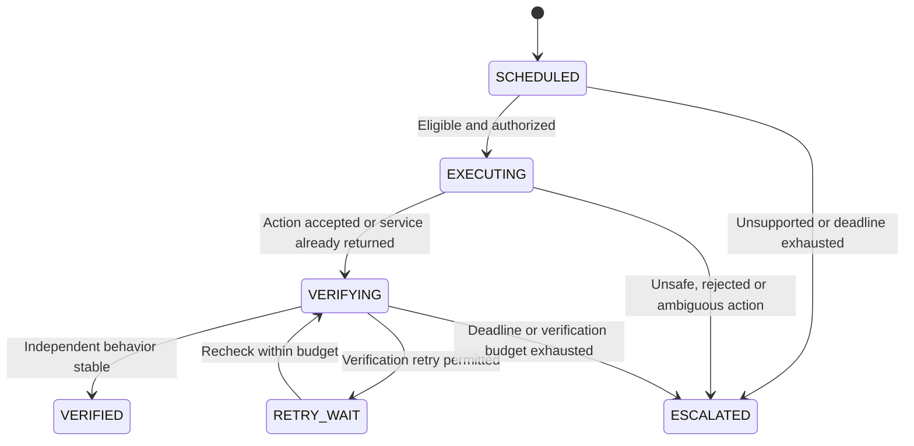
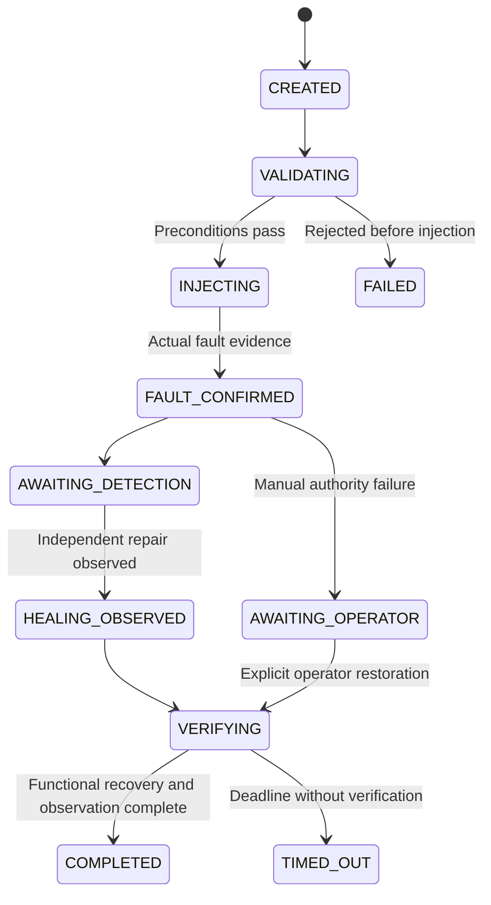

# StreamShield: complete technical guide

**Implementation reviewed:** `feature/reliable-live-studio`, application baseline
`c7b37ee` with the startup-readiness correction reviewed on 27 October 2026.
This guide describes the code on that branch. It is
intended for developers, project reviewers, operators and technical presentations.

For the exact Windows commands, use [Windows local setup](WINDOWS_LOCAL_STUDIO.md).
Earlier phase documents preserve the state of earlier implementations; where they
differ, this guide and the current source describe the reviewed branch.

## Contents

1. [Purpose and capabilities](#1-purpose-and-capabilities)
2. [Technology stack and responsibilities](#2-technology-stack-and-responsibilities)
3. [Deployment modes and service topology](#3-deployment-modes-and-service-topology)
4. [Architecture and request paths](#4-architecture-and-request-paths)
5. [Accounts, authorization and sessions](#5-accounts-authorization-and-sessions)
6. [Channels, streams and publishing credentials](#6-channels-streams-and-publishing-credentials)
7. [Browser broadcasting and OBS](#7-browser-broadcasting-and-obs)
8. [Broadcast lifecycle and discovery](#8-broadcast-lifecycle-and-discovery)
9. [Video delivery, playback and failover](#9-video-delivery-playback-and-failover)
10. [Chat, moderation and viewer presence](#10-chat-moderation-and-viewer-presence)
11. [Data model and persistence](#11-data-model-and-persistence)
12. [Monitoring, incidents and health](#12-monitoring-incidents-and-health)
13. [Autonomous healing](#13-autonomous-healing)
14. [Chaos experiments and the five failure buttons](#14-chaos-experiments-and-the-five-failure-buttons)
15. [Additional failure scenarios in the larger topology](#15-additional-failure-scenarios-in-the-larger-topology)
16. [Dashboard states, timelines and visible impact](#16-dashboard-states-timelines-and-visible-impact)
17. [System logs, metrics and analysis](#17-system-logs-metrics-and-analysis)
18. [HTTP and real-time interfaces](#18-http-and-real-time-interfaces)
19. [Configuration, ports and startup](#19-configuration-ports-and-startup)
20. [Deployment, updates and operations](#20-deployment-updates-and-operations)
21. [Testing and measured evidence](#21-testing-and-measured-evidence)
22. [Capacity, limitations and production work](#22-capacity-limitations-and-production-work)
23. [Troubleshooting by symptom](#23-troubleshooting-by-symptom)
24. [Repository map and extension guide](#24-repository-map-and-extension-guide)
25. [Technical questions and glossary](#25-technical-questions-and-glossary)

## 1. Purpose and capabilities

StreamShield combines a live streaming application with an operational control
application. **StreamShield Live** handles discovery, user-owned channels, Studio,
live viewing and chat. **StreamShield Control** observes the infrastructure,
records incidents, displays recovery evidence and lets an administrator request
controlled local failures.

The project demonstrates a complete loop: create a real broadcast, deliver real
media, inject a real bounded fault, detect it independently, perform an allowed
repair, and verify the repaired service's behavior. Success depends on evidence;
an animated timeline or a successful Docker command alone does not establish
recovery.

The current implementation includes registration/login, channel ownership,
per-stream publishing keys, browser camera/screen broadcasting, OBS publishing,
HLS playback, real-time chat, moderation, approximate active-player presence,
redundant API and video paths in the resilience topology, health monitoring,
predefined repair playbooks, audited experiments, understandable system logs and
a manually restored media-authorization failure.

The Healer uses explicit policies written in TypeScript. It does **not** use
Claude, an LLM or a machine learning model to choose repairs. The fifth button
demonstrates an honest limit of automation: unavailable external authority cannot
be recreated by restarting a container.

## 2. Technology stack and responsibilities

Versions below describe the reviewed manifests or pinned container tags. npm
manifests use version ranges; `package-lock.json` records the resolved dependency
tree installed by `npm ci`.

| Technology                                | Where it is used                              | Responsibility and reason                                                                                        |
| ----------------------------------------- | --------------------------------------------- | ---------------------------------------------------------------------------------------------------------------- |
| TypeScript 6                              | Browser, API, shared contracts                | Static checking across service boundaries; describes states and allowed operations explicitly.                   |
| Node.js 24                                | API, controllers, setup and test scripts      | HTTP services, asynchronous I/O, process supervision and built-in SQLite journals.                               |
| npm workspaces                            | Repository root                               | Manages the web, API and shared package together.                                                                |
| React 19 / React DOM                      | `apps/web`                                    | Discovery, Studio, Watch, chat and Control interfaces.                                                           |
| React Router 7                            | Browser routing                               | Separates consumer routes from `/control/*` and preserves navigation behavior.                                   |
| TanStack Query 5                          | Browser data fetching                         | Query caching, refreshes, invalidation and explicit loading/error states. It is not the durable source of truth. |
| Vite 8                                    | Web tooling                                   | Development server, development proxies and optimized static production assets.                                  |
| CSS, including Studio/Control theme files | Browser presentation                          | Responsive charcoal/red UI, layouts, status colors and real recovery indicators.                                 |
| Tailwind CSS 4 Vite integration           | Web build                                     | Processes Tailwind styles alongside the application's custom CSS.                                                |
| Express 5                                 | API and private service listeners             | REST endpoints, middleware, health endpoints and restricted internal interfaces.                                 |
| Zod 4                                     | Shared contracts and configuration            | Runtime validation of requests, responses and environment configuration.                                         |
| PostgreSQL 17.9                           | Durable application/operations data           | Accounts, sessions, channels, streams, chat, incident history and experiment/recovery audit data.                |
| `pg`                                      | API and operational services                  | SQL queries, transactions and connection pools. There is no ORM.                                                 |
| `node-pg-migrate` 9                       | Migration job                                 | Applies ordered schema migrations without resetting existing data.                                               |
| Redis 8.6.2                               | Ephemeral shared state                        | Socket.IO distribution, rate-limit counters and expiring presence leases. It is not the durable chat database.   |
| Socket.IO 4 / Redis adapter               | Real-time application layer                   | Chat rooms, reconnects, moderation/discovery notifications and cross-API delivery.                               |
| Argon2id / `@node-rs/argon2`              | Authentication                                | One-way password hashing; passwords are not stored as plain text.                                                |
| Node crypto                               | Security and identities                       | Random tokens, SHA-256 token digests, HMAC CSRF tokens and constant-time comparisons.                            |
| Helmet / CORS middleware                  | API boundary                                  | HTTP security headers and configured browser-origin restrictions.                                                |
| Pino 10                                   | Service logging                               | Structured diagnostic logs with service/request identity.                                                        |
| MediaMTX 1.21.2, FFmpeg variant           | Ingest relay and video origins                | RTMP/WebRTC ingest, RTSP replication and HLS remuxing.                                                           |
| WebRTC / WHIP                             | Browser publishing                            | Sends live browser capture to MediaMTX; WHIP negotiates the publishing session over HTTP.                        |
| HLS / fragmented MP4                      | Audience delivery                             | HTTP playlists, initialization data and time-based media segments.                                               |
| hls.js 1.7 / native HLS                   | Watch and remote player                       | Browser playback, buffering/error events and bounded reconnection.                                               |
| Nginx 1.30.6                              | Web server, API gateway, video gateway, edges | Static assets, reverse proxying, API balancing and video delivery/caching.                                       |
| Docker Engine / Compose                   | Local deployment                              | Container processes, private networking, health checks, ports and named volumes.                                 |
| SQLite via `node:sqlite`                  | Healer, action and Chaos journals             | Local durable intent, identities, leader leases, operation budgets and ambiguous-action records.                 |
| Toxiproxy 2.13.0                          | Failure demonstration                         | Injects actual delay or connection disruption on the private simulated dependency path.                          |
| Custom circuit breaker                    | Healer dependency client                      | Prevents repeated slow requests and verifies safe read reconnection.                                             |
| `@prometheus-io/client`, Prometheus 3.15  | Optional full telemetry topology              | Counters/histograms, metric collection and time-series queries.                                                  |
| Grafana 13.2.4                            | Optional full telemetry topology              | Operational dashboards over collected metrics. Omitted by the lightweight demo.                                  |
| tsup                                      | Backend build                                 | Bundles TypeScript entry points into compiled JavaScript.                                                        |
| Vitest, Testing Library, Supertest        | Automated checks                              | Policies, UI states, contracts, HTTP behavior and security boundaries.                                           |
| Playwright / Chromium                     | Browser acceptance                            | Real publishing/playback workflows, decoded progress, chat and fault UI verification.                            |
| FFmpeg / ffprobe                          | Test media and measurements                   | Generated live sources and media inspection. They do not establish a production transcoding service.             |
| ESLint / Prettier / GitHub Actions        | Development workflow                          | Static checks, formatting and automated integration workflows.                                                   |

## 3. Deployment modes and service topology

The repository contains several compositions built during successive phases.
They are related but do not all start the same services.

| Mode                        | Entry point                     | What it starts or demonstrates                                                                                            |
| --------------------------- | ------------------------------- | ------------------------------------------------------------------------------------------------------------------------- |
| Base persistent platform    | Root `docker-compose.yml`       | PostgreSQL, Redis, migration job, one API, MediaMTX and Vite web server. No independent Healer/Chaos topology by default. |
| Resilience                  | `resilience:*` scripts          | Adds API balancing, two edges, primary/standby origins and a video gateway.                                               |
| Monitoring                  | `monitoring:*` scripts          | Adds independent observations, incidents and full telemetry components.                                                   |
| Healing                     | `healing:*` scripts             | Adds the Healer, restricted repair adapter, journals and dependency circuit demo.                                         |
| Chaos                       | `chaos:*` scripts               | Adds controlled local fault authority and experiment orchestration.                                                       |
| Fixed three-channel demo    | `demo:*` scripts                | Optional provisioned channels, guest behavior and local operator access.                                                  |
| Dynamic/final topology      | `dynamic:*` / `final:*` scripts | Public accounts, user-owned dynamic broadcasts, browser WHIP and the larger recovery presentation.                        |
| Lightweight disposable demo | `npm run demo:light`            | Temporary integrated streaming/failure environment with four automatic/resilience scenarios and one manual scenario.      |

### The Windows arrangement used in this project

| Deployment             | Browser address         | Data lifetime                                                                |
| ---------------------- | ----------------------- | ---------------------------------------------------------------------------- |
| `streamshield-main`    | `http://127.0.0.1:5173` | Persistent application database in its named volume.                         |
| `ss-light-<random ID>` | `http://127.0.0.1:5174` | Disposable accounts, broadcasts, database and control journals for that run. |

These deployments have separate project identities and credentials. A failure
button on 5174 affects **only the disposable demo**. A stream on 5173 should not
stop because a separate 5174 service was killed.

The base persistent composition does not enable browser WHIP merely by displaying
Studio. Browser broadcasting requires the dynamic overlay, as supplied by the
lightweight demo or dynamic deployment. Use 5174 for the integrated browser
broadcast/failure workflow described here.

### Lightweight topology details

The lightweight runner keeps the actual fault targets separate: API-1, the video
gateway and Edge-1 are independently stoppable containers. PostgreSQL, Redis,
MediaMTX relay, both origins, both edges, video gateway, API-1, API gateway,
Toxiproxy, web and a control-plane container form the 13-container fixture.

To reduce overhead, the control-plane container supervises separate processes for
API-2, the Observer, Healer, repair adapter, simulated dependency, Chaos controller
and fault adapter. This is process separation on one trusted machine, not
independent hosts. Losing that container also loses the colocated API peer and
control processes. API-2 runs with a restricted UID/GID; startup verifies that it
cannot access the mounted Docker socket. Trusted adapter processes have the
privilege needed for their reviewed actions.

Prometheus, Grafana, the spare API-3 and API-tier capacity observations are omitted
from this compact profile. A missing optional telemetry service is not silently
treated as a running one. The full topology provides broader scenarios.

## 4. Architecture and request paths

The application has three cooperating parts:

- **Application services:** accounts, metadata, Studio, discovery, chat and presence.
- **Media delivery:** capture, ingest, replication, HLS packaging, edges and playback.
- **Operational control:** independent probes, incidents, repair policy, restricted
  actions and experiment auditing.

The API handles metadata and permissions. It does not forward every video frame
through an Express route.

Liveness asks whether the API process is alive. Readiness additionally checks
that it is accepting work and can use required database/Redis connections. The
readiness helper coalesces dependency checks, uses a short cache and bounds its
HTTP waiting time; a slow dependency must not create an unbounded queue of new
readiness queries. Neither endpoint alone proves video is playable.



Typical URL paths have different destinations:

| Browser request                            | Destination                            | Meaning                                                                 |
| ------------------------------------------ | -------------------------------------- | ----------------------------------------------------------------------- |
| `/`, `/studio`, `/watch/:id`, `/control/*` | Web assets / React router              | Loads a page in the browser.                                            |
| `/api/v1/*`                                | API gateway → Express                  | Metadata, sessions, Studio and administrative projections.              |
| `/socket.io/*`                             | API gateway → Socket.IO                | Real-time application events.                                           |
| `/media/*`                                 | Video gateway → edge → selected origin | Audience video bytes. Primary and standby have distinct route prefixes. |
| `/ingest/<media-path>/whip`                | Web proxy → MediaMTX WHIP              | Browser publishing negotiation; actual media then uses ICE.             |

The origin-pull arrows in the diagram describe the resulting media flow. Origins
actively pull the relay's RTSP stream; browsers do not connect to that private
replication endpoint.

WebRTC is used for creator ingest. The reviewed audience Watch path uses HLS;
the project does not claim that every viewer receives a WebRTC session or
sub-second end-to-end latency.



Chaos applies the requested fault; it does not secretly restart the target to
make its own experiment pass. Infrastructure recovery belongs to the Healer.
Timed fault removal, browser reconnects and operator restoration are recorded as
their own mechanisms.

## 5. Accounts, authorization and sessions

### Registration and login

Registration validates the submitted account, applies a shared rate limit,
hashes the password with Argon2id and inserts a user. Argon2id currently uses
19,456 KiB of memory, two iterations and parallelism one. Login verifies the
stored hash; an absent account still takes the verification path using a dummy
hash to reduce account-dependent timing differences.

A successful login issues a cryptographically random 32-byte session token.
The raw token is placed in `ss_session`; PostgreSQL stores its SHA-256 digest,
expiry and revocation state. The server resolves the session against current
database state instead of trusting a role supplied by the browser. This is a
server-side cookie session design, not JWT authentication.

Cookies use HttpOnly and SameSite=Lax. Secure cookies are configurable for local
HTTP and required by production configuration. Logout revokes the session and
disconnects its associated sockets. Expired or revoked sessions cannot continue
performing authenticated operations.

### CSRF and origin checks

`GET /api/v1/auth/me` returns the signed-in identity, a CSRF token and relevant
client settings. The CSRF token is an HMAC over a random cookie nonce. Mutating
requests must present the correct token and an explicitly permitted Origin.
Socket authentication also validates the relevant session/CSRF context.

This protects authenticated writes against cross-site requests. CORS alone
would not establish permission to publish, moderate or inject a failure.

### Roles and ownership

| Role          | Typical capabilities                                                                     |
| ------------- | ---------------------------------------------------------------------------------------- |
| Viewer        | Public discovery/viewing; authenticated chat where permitted.                            |
| Broadcaster   | Owns a channel, creates its broadcasts, publishes and moderates its channel.             |
| Administrator | Reads Control information and requests permitted experiments or manual demo restoration. |

Creating a channel upgrades an ordinary viewer account to broadcaster in the
same transaction. Registration cannot request administrator status. A trusted
operator grants it through `scripts/set-role.mjs` / `account:role`.

Ownership is checked in SQL and server handlers. A stream ID or a visible edit
button does not grant the right to mutate someone else's channel. Administrative
access also does not enable absent services or bypass disabled repair policies.

## 6. Channels, streams and publishing credentials

A channel belongs to one account; the schema enforces one channel per owner and
a unique slug. A stream belongs to a channel and has its own title, category,
description, UUID and random media path such as `s-<32 hexadecimal characters>`.
The media path is not the user's password or a shared global stream name.

Creating a stream produces metadata. It does not mean a camera is connected or
that an audience can play video. Preparing publishing creates a separate random
credential and moves the database lifecycle into the appropriate ready state.
The database stores only the publishing credential digest.

Publishing preparation returns the owner a server URL, path, user identity,
secret key, OBS stream-key format and, in dynamic mode, a WHIP URL. These values
must stay private. Public stream DTOs do not contain publishing credentials.

MediaMTX asks a private authenticated callback whether publishing is allowed.
The callback checks protocol, stream identity, path, lifecycle, owner role and
credential digest. The callback listener is separate from the public API and is
not an arbitrary public authorization proxy. Private replication has a distinct
credential from publishing and media-control access.

Audience HLS is publicly readable through the intended delivery path; application
login is not a per-segment viewer-entitlement or DRM system. Internal origin
credentials protect service-to-service access. They are distinct from a paid
subscription/viewer authorization feature, which this implementation does not
provide.

### Key replacement and ending a stream

Before installing a replacement key, the application revokes the previous key
and disconnects matching active publishers through MediaMTX's authenticated
Control API. It checks RTMP and, when enabled, WebRTC inventories under a shared
bounded deadline, then kicks only connections publishing the exact path.

If disconnection cannot be confirmed, key preparation fails closed. It does not
issue a new usable credential while pretending the old publisher is gone.
`MEDIA_CONTROL_TIMEOUT_MS` is separate from the short monitoring probe budget.

Browser cancellation includes the credential of that publishing attempt. The
database updates the stream only if the expected digest still matches, so a
stale tab cannot revoke or end a newer replacement publisher. An ended stream
requires a new broadcast for another publishing attempt.

## 7. Browser broadcasting and OBS

### Browser camera or screen publishing

```mermaid
sequenceDiagram
  participant Creator as Creator browser
  participant API as StreamShield API
  participant Media as MediaMTX
  participant Discovery as Discovery observer
  Creator->>Creator: Preview camera or share screen
  Note over Creator: Local capture only; not publicly live
  Creator->>API: Prepare owned publishing attempt
  API->>Media: Read inventories / disconnect replaced publisher
  API-->>Creator: Scoped publishing credentials + WHIP URL
  Creator->>Media: Authenticated SDP offer over WHIP
  Media->>API: Private publishing authorization
  API-->>Media: Allow or deny
  Media-->>Creator: SDP answer + session resource
  Creator->>Media: ICE connection and live WebRTC media
  Discovery->>Media: Check source / manifest / byte progress
  Discovery->>API: Persist verified LIVE observation
  Creator->>API: Poll broadcast verification
  API-->>Creator: Verified LIVE, or explicit failure
```

`BrowserStudio.tsx` owns the capture stream, preview, device controls, mute,
publishing attempt, reconnects and cleanup. `getUserMedia` captures camera/audio;
screen sharing uses browser display capture. A local preview proves device
capture only. Start Live initiates the network publishing workflow.

`whip.ts` creates a send-only `RTCPeerConnection`, prefers supported H.264 video
and Opus audio, gathers ICE candidates, posts an authenticated SDP offer and
applies the answer. It validates the returned session resource before deletion.
Negotiation, HTTP requests and peer connectivity have separate deadlines. The
current implementation waits up to 20 seconds for the peer connection after
negotiation; server-side LIVE verification has a 45-second deadline.

Browser publishing uses **two connections**: HTTP WHIP signaling and ICE media.
An accepted WHIP response can still be followed by an ICE failure. Local Docker
networking must publish the advertised ICE port on both UDP and TCP. The local
setup advertises loopback and does not configure public STUN/TURN traversal.

The interactive demo uses port **18189** for ICE so it can coexist with the main
application's default **8189**. Keep the Studio tab open: it owns capture and
publishing. Watch links open separately so navigation does not discard the
broadcasting page. Device track termination and failed attempts trigger scoped
cleanup rather than leaving an unverified stream labelled live.

After an ingest failure, the browser can republish using bounded backoff while
capture is still available. That is a **client reconnection**. The Healer restores
the ingest service; it does not recreate the camera or keep an unplugged capture
device alive.

### OBS and FFmpeg

OBS publishes encoded media over RTMP to the relay using the owned stream's
server and full stream key. The tested OBS/FFmpeg codec path uses H.264 video,
compatible pixel format, AAC audio and regular keyframes, commonly every two
seconds. Browser publishing uses its negotiated H.264/Opus path; compatibility
with every native HLS client is not implied.

The disposable runner also starts a labelled generated sample source for stable
baseline checks. It is real encoded media, not the broadcaster's camera. Keep it
running while demonstrating failures. The fixture assigns a dynamic RTMP host
port; its port is not automatically main-app port 1935.

MediaMTX generally **remuxes** media into the delivery format. This project does
not provide a production adaptive-bitrate transcoding ladder or cloud recording
pipeline merely because a streaming-tool design inspired the interface.

## 8. Broadcast lifecycle and discovery

Three concepts are deliberately separate:

| Concept                 | Example values                               | What establishes it                                          |
| ----------------------- | -------------------------------------------- | ------------------------------------------------------------ |
| Database lifecycle      | `draft`, `ready`, `ended`                    | Authorized application operations and lifecycle transitions. |
| Observed media status   | `offline`, `starting`, `live`, `unavailable` | Publisher/origin/control and bounded HLS observations.       |
| Dynamic broadcast state | `CREATED`, `PUBLISHING`, `LIVE`, etc.        | Persisted state derived from actual source/media progress.   |

| Dynamic state     | Meaning                                                                                       |
| ----------------- | --------------------------------------------------------------------------------------------- |
| `CREATED`         | Metadata exists; publishing is not prepared.                                                  |
| `PREPARING`       | Ready to establish a source, but verified live media is absent.                               |
| `PUBLISHING`      | Source/media is starting; the evidence is not sufficient for LIVE yet.                        |
| `LIVE`            | Source/manifest evidence and recent advancing input-byte evidence establish a live broadcast. |
| `CONNECTION_LOST` | A previously active source is absent inside its grace period.                                 |
| `RECONNECTING`    | Previously active media is being re-established or is not currently progressing.              |
| `ENDING`          | End/cancel has been requested; targeted publisher cleanup is underway.                        |
| `ENDED`           | The session ended; its publishing authority is revoked.                                       |
| `FAILED`          | Startup or verified-media requirements were not met.                                          |

`observeBroadcast` obtains source byte counters from MediaMTX and locks the stream
row in a PostgreSQL transaction. A counter change with positive current/prior
values is progress evidence; a connected publisher alone is insufficient. Recent
progress remains valid only inside the configured TTL. The default dynamic
progress TTL is six seconds; default source-loss grace is eight seconds. These
are observation policies, not guarantees about how long a player's buffer lasts.

An unavailable observation preserves the previously persisted broadcast state
instead of inventing an ended source. The response still identifies current
observation unavailability; old LIVE metadata is not fresh playback proof.

Discovery runs independently of browser visits. Every two seconds a bounded
scanner tries a PostgreSQL advisory lock, scans at most 32 ready records and
observes them in groups of four. The lock avoids concurrent scanners doing the
same database work. State changes persist `broadcast_events` and emit discovery
notifications. Search, category filters and live discovery use server metadata
and verified broadcast observations.

## 9. Video delivery, playback and failover

### Relay, origins and edges

The relay accepts the source. Primary and standby origins pull authorized RTSP
media from it and package separate HLS outputs. A source-lifetime warm-up loop
requests both origins so an on-demand standby is genuinely producing media
before it is needed. A second empty container is not a usable standby.

Edges request a specified primary or standby route, attach the internal media
credential, strip application cookies and cache eligible successful segment
files. Playlists bypass segment caching. Initialization/media segments use a
short configurable cache; fresh playlists must continue identifying current
media. The video gateway sends the request to an available edge.

For the lightweight demo, Edge-2 is configured as a backup so actual movement
from Edge-1 can be observed. Serving-edge headers provide delivery evidence when
enabled. The gateway does not treat every origin HTTP error as evidence that an
otherwise healthy edge should be removed.

### Browser playback

`LivePlayer.tsx` uses hls.js when Media Source Extensions are supported, with
native HLS where appropriate. It reports states derived from actual media events:
loading, playing, buffering, reconnecting, paused, autoplay blocked, unsupported
or error. Muted startup follows browser autoplay constraints.

A bounded load/no-progress watchdog detects stalled media. Fatal errors or lost
progress trigger bounded backoff and source reconnection. The example defaults
allow 12 retries with one-second initial and eight-second capped delay. Actual
configuration can override these values. Advancing decoded playback restores
the retry budget; a manual Retry starts a fresh playback attempt.

On suitable delivery failures, the player switches from primary to the distinct
standby source. Once on standby it does not force an immediate switch back just
because primary returned. Each source has its own HLS session/timeline, so
switching can require initialization and brief buffering.

The player releases HLS instances, listeners, timers and media resources on
unmount. Metadata refresh failure does not automatically destroy an already
playing video element.

### What buffering and continuity prove

An HLS viewer consumes previously buffered segments. A server can stop before
the buffer empties. A quickly repaired service may produce no visible freeze.
Likewise, an edge or API can fail while a healthy peer continues serving.

The application therefore reports server repair, failover, browser stalls and
decoded playback separately. It does not artificially pause a healthy player
to exaggerate a fault. API failover is visible through actual serving-instance
responses; video-gateway loss and media-authorization loss affect video requests.

## 10. Chat, moderation and viewer presence

### Message flow

A browser establishes a Socket.IO WebSocket transport, validates its allowed
session context and joins a stream-specific room. Sending requires current
authorization, valid bounded text, rate-limit allowance and moderation checks.
Accepted persistent messages are written to PostgreSQL with an ordered sequence
and distributed through Socket.IO. The Redis adapter fans messages out across
API instances using separate publish/subscribe connections.

The client merges messages by ID, orders by database sequence and bounds its
in-memory display. Reconnection rejoins the stream and fetches durable history.
History pagination supports older messages without requiring the entire chat
table to be loaded. React renders message text rather than accepting arbitrary
HTML. Message length is bounded; the base database constraint allows 1–1,000
characters.

Studio embeds the same actual stream chat beside the capture preview, with a
broadcaster composer. Audience messages and creator replies use the same room;
they are not generated UI examples. The local preview is not counted as a second
audience player.

Channel owners/authorized moderators can delete messages or ban users within
the channel's scope. Moderation notifications remove affected messages from
connected views. A ban record belongs to a channel/user pair.

### Presence and its limits

Presence represents approximate **active players**, using expiring Redis leases
for advancing visible playback. Pause, page visibility, disconnect and lease
expiry affect presence. Tabs sharing a login/anonymous identity are deduplicated
within the implemented identity rules. Example defaults use five-second
heartbeats and a 30-second TTL.

This does not measure unique humans, every direct HLS client, or television
players outside this browser integration. Browser identity and actual delivered
segments are different measurements.

### During Redis or API loss

An API crash can disconnect sockets attached to that instance. The remaining API
handles new/reconnecting application traffic. Redis loss interrupts shared chat
distribution, presence and rate-limit availability. PostgreSQL chat history
survives independently. Redis Pub/Sub does not durably replay messages that were
missed in transit; reconnect/history catch-up is a separate mechanism. Video
already flowing through the media path can continue.

## 11. Data model and persistence



The diagram summarizes relationships; the SQL migrations are the exact schema.
Not every operational correlation is a database foreign key: experiment bodies
also retain incident/recovery IDs and timestamped evidence.

| Table/group                                                  | Stored information                                                                                         |
| ------------------------------------------------------------ | ---------------------------------------------------------------------------------------------------------- |
| `users`                                                      | Canonical unique username/email, password hash, role and profile.                                          |
| `auth_sessions`                                              | Session-token digest, owning user, expiry/revocation.                                                      |
| `channels`                                                   | Owner, unique slug, title/description.                                                                     |
| `streams`                                                    | Channel, metadata, unique media path, publishing digest, lifecycle, dynamic state and progress timestamps. |
| `chat_messages`                                              | Ordered durable messages, sender/stream, deletion marker and timestamps.                                   |
| `broadcast_events`                                           | Persisted broadcast-state transitions.                                                                     |
| `chat_bans`                                                  | Channel-scoped moderation restrictions and actor.                                                          |
| `monitoring_state`, `monitoring_components`                  | Last persisted observation/version and component state.                                                    |
| `monitoring_incidents`, `monitoring_incident_events`         | Confirmed failures, diagnoses, state changes and evidence.                                                 |
| `monitoring_state_changes`                                   | Time-ordered component transitions for timelines/logs.                                                     |
| `healing_attempts`, `healing_events`, `healing_verification` | Repair identities, outcomes, audit events and verification markers.                                        |
| `chaos_experiments`                                          | Experiment identity, actor, scenario, state and structured evidence/events.                                |
| `chaos_browser_evidence`                                     | Bounded browser measurements linked to an experiment.                                                      |
| `demo_*` tables                                              | Optional fixed-channel demo, guests, local tickets and broadcast history.                                  |
| `capacity_runs`, `capacity_workers`, `capacity_samples`      | Authorized workload grants, worker reporting and samples.                                                  |
| `schema_migrations`                                          | Applied migration history.                                                                                 |

Important constraints include unique canonical accounts, unique media paths,
one channel per owner and, in dynamic mode, at most one ready dynamic publishing
session per channel. Transactions protect session replacement, channel creation,
credential lifecycle and observed broadcast changes.

### PostgreSQL, Redis and SQLite have different jobs

PostgreSQL is durable business and audit storage. Redis holds expendable
distribution/counter/lease state; the local Redis configuration disables
snapshot/AOF persistence. SQLite journals preserve control intent locally before
or alongside external effects and synchronize audit data to PostgreSQL.

The SQLite implementation uses WAL, FULL synchronization, a bounded busy timeout
and private file permissions. Control operations interrupted while marked
executing become ambiguous. The same uncertain operation is not blindly replayed.

The persistent deployment uses named volumes. The disposable fixture replaces
data volumes with run-scoped temporary storage, including tmpfs, and keeps
sanitized result artifacts on the host. Closing the demo is expected to discard
its temporary database, accounts and broadcasts. JSON reports/screenshots are
evidence, not a database backup.

## 12. Monitoring, incidents and health

The Observer is independent of the frontend and failed application instance.
It probes configured targets with bounded concurrency and deadlines, including
HTTP/API readiness, database `SELECT 1`, authenticated Redis PING, MediaMTX
control responses and real media delivery observations. Full telemetry mode also
derives API-tier load health from actual metrics.

Media work runs on a separate loop so a slow HLS check does not block component
probes and persistence. Incident writing uses bounded database locks/transactions;
independent probes continue if persistence is temporarily unavailable. Missing
persistence is reported explicitly and restricts operations that require it.

### Thresholds and freshness

One slow response is not immediately a confirmed crash. The policy maintains
consecutive failures/successes and failure timestamps. Default configuration
requires two failures to confirm and two successes to return to Healthy. A
responding component can pass through Recovering before stable Healthy.

The interactive lightweight runner supplies these defaults unless the operator
explicitly overrides them:

| Setting                   | Interactive value | Purpose                                                     |
| ------------------------- | ----------------- | ----------------------------------------------------------- |
| `OBS_INTERVAL_MS`         | 4,000 ms          | Target interval between observation cycles.                 |
| `OBS_TIMEOUT_MS`          | 3,000 ms          | Individual observation budget.                              |
| `OBS_STALE_MS`            | 20,000 ms         | Age after which observations cannot support current claims. |
| `HEALER_PROBE_TIMEOUT_MS` | 3,000 ms          | Independent repair-verification probe budget.               |
| `CHAOS_PROBE_TIMEOUT_MS`  | 3,000 ms          | Experiment verification budget.                             |

These are not promised detection/recovery times. Work, scheduling, consecutive
checks and dependent verification also take time. A Docker Desktop host under
resource pressure can exceed them.

### Failure classification

| Observation code/state  | Interpretation                                                                               | Consequence                                                                              |
| ----------------------- | -------------------------------------------------------------------------------------------- | ---------------------------------------------------------------------------------------- |
| `probe_unreachable`     | Connection refused, DNS/connect failure, reset or similar inability to reach an answer path. | May justify starting a stopped managed service after confirmation and Docker inspection. |
| `probe_timeout`         | An accepted operation did not answer in time.                                                | Could be a hang or congestion; requires extra diagnosis before restart.                  |
| `probe_denied`          | Monitoring credentials/permissions were rejected.                                            | Target state is unknown; rejected observer authority is not proof the service crashed.   |
| `RECOVERING`            | Good probes have returned but stable success threshold is pending.                           | Continue verification.                                                                   |
| `UNKNOWN` or stale data | Current state cannot be established.                                                         | Do not invent Healthy or a successful repair.                                            |

The overall monitoring state considers redundancy groups and critical singleton
services. One failed peer can degrade redundancy without stopping all traffic.
Losing both peers or a critical singleton can establish a broader outage.

Confirmed failures create durable incidents with correlation IDs, first observed
time, confirmed/detected time, codes and events. Detection timing is based on
observed evidence; delayed persistence is labelled rather than backdated as an
instantaneous write.

## 13. Autonomous healing

### Recovery loop

1. Read fresh confirmed observations and correlate the incident/episode.
2. Choose a predefined playbook using **component and symptom**.
3. Check allowed service, dependencies, leader authority, budgets and safety.
4. Persist the attempt and durable action intent.
5. Send one allowed request to the restricted repair adapter.
6. Record the adapter receipt or an explicit denied/ambiguous outcome.
7. Independently verify application/media behavior for a stability window.
8. Mark Verified, wait/retry within policy, or escalate to human review.

The Healer runs with the dashboard closed. The browser requests/observes
experiments; it does not execute the repair loop.



### Playbooks

| Playbook                   | Trigger/target                           | Allowed behavior                                                     | Verification                                                            |
| -------------------------- | ---------------------------------------- | -------------------------------------------------------------------- | ----------------------------------------------------------------------- |
| `api-start`                | Managed API unreachable/exited           | Start the stopped API container.                                     | Readiness, real catalog reads and actual gateway routing.               |
| `api-restart-unresponsive` | API probe timeout with running container | Restart only after corroborating hang, healthy peer and load checks. | Ready/catalog/routing plus bounded responsiveness.                      |
| `gateway-start`            | Video gateway exited                     | Start that gateway only.                                             | Real HLS bytes and advancing segments through the gateway.              |
| `edge-start`               | Delivery edge exited                     | Start that edge; preserve its peer.                                  | Authorized playlists/init/media data and progression.                   |
| `primary-start`            | Primary origin exited                    | Start after standby media is verified.                               | Live paths receive advancing primary media; no forced failback.         |
| `redis-start`              | Redis exited                             | Start Redis without replaying lost Pub/Sub.                          | Authenticated PING and dependent API readiness.                         |
| `relay-start`              | Ingest relay exited                      | Start relay; source must reconnect itself.                           | Relay API and RTMP/WHIP listeners; source return separately recorded.   |
| `api-scale-out`            | Confirmed API-tier overload              | Start a pre-created API-3 spare.                                     | Spare actually serves through gateway and tier behavior recovers.       |
| `api-scale-in`             | Sustained normal tier load               | Stop only the spare.                                                 | Permanent APIs still serve; spare returns to standby.                   |
| `dependency-reconnect`     | Read-only dependency failing             | Bounded safe reads through circuit policy.                           | Successful reconnection/probe sequence.                                 |
| `database-review`          | Database/storage failure                 | Escalate for operator review.                                        | External restoration may later be independently observed.               |
| `source-wait`              | Publisher missing                        | Observe/wait for broadcaster return.                                 | Source/media progress; never synthetic replacement of someone's camera. |

### Distinguishing a crash from a hang

A start request cannot fix an already running frozen process. A restart is also
unsafe if the symptom is simply an overloaded host. For timeout-driven API
repair, the Healer checks a healthy peer, a persistent timeout window, tier load
and its own corroborating probe. Default hang confirmation is ten seconds; a
busy tier should use capacity policy instead of removing a serving instance.

Docker inspection can supersede an earlier timeout diagnosis: if the API is now
confirmed exited, the attempt is revised to the start playbook. This prevents
requesting a running-container restart against an exited container, which would
be correctly rejected as `unsafe_container_state`.

### Action authority and budgets

The repair adapter identifies containers by the configured Compose project,
service label and Healer-managed identity. It does not accept arbitrary shell
commands, container names, image creation or deletion through the public API.
Start-only targets must actually be exited, apart from a never-started spare.
Running-container restart is restricted to the designated APIs; OOM states
escalate for resource review. Stop authority applies to spare capacity only.

Leader leases include owner, epoch and expiry. Attempts carry an identity and
epoch so stale leaders or replayed requests cannot repeat effects. Default policy
allows two operations per service per ten-minute window with a 30-second
cooldown. These limits are shared by the relevant start/restart/stop operations.
One open recovery attempt per component absorbs flapping evidence rather than
launching competing repairs. A cycle initiates at most one side effect while
verification of other work continues.

The adapter's default action budget is five seconds; functional verification
defaults to a 60-second window with a three-second stability requirement. Bounded
attempt/backoff policies still apply. These values are configuration, not a
guaranteed recovery service level.

### Functional proof

API recovery requires more than an open port. The repaired instance must be
ready, return a real stream catalog and participate in gateway traffic. Media
verification resolves valid playlists and checks actual initialization/segment
bytes and changing media. Redis verification includes dependent API behavior.
Source recovery remains separate from relay process recovery.

Independent API and video baseline checks run concurrently and retain separate
results. Failure to verify HLS does not erase a successful API check. The current
verifier samples a bounded set of live paths; this is not proof that every
possible viewer/network/source is healthy.

## 14. Chaos experiments and the five failure buttons

### Admission and experiment identity

Experiments require an administrator, CSRF/origin validation, impact acknowledgement,
the typed target, an allowed local scenario and a unique request identity. The
controller requires fresh observations, a healthy functional baseline, durable
state, relevant repair authority/budget and no conflicting active experiment.
Only one experiment may be active. A failed prerequisite is recorded before
injection instead of applying a fault that cannot be safely evaluated.

The request identity provides idempotent lookup. If the response to a write is
lost, the client checks the same experiment rather than inventing a second
request. An ambiguous accepted fault stays unverified until receipts and actual
evidence resolve it.



The implementation also records cancellation, failed cleanup, pending receipts
and observation-unavailable events. This diagram shows the main paths rather
than every exceptional transition.

### Button 1: API Server Crash

**Typed target:** `api-1`. **Scenario:** `crash-api`.

- **Fault:** the fault adapter sends SIGKILL to the actual API-1 container.
- **Immediate effect:** in-flight requests and sockets on that instance can
  disconnect; new eligible requests fail over through the API gateway to API-2.
- **Video:** can continue because the API is not the video transport path.
- **Repair:** independent observations confirm the problem; the Healer selects
  the stopped-API start playbook and the adapter starts the managed container.
- **Proof:** readiness, catalog reads, gateway participation, recorded action
  receipt and stable observations establish recovery.
- **Visible evidence:** API card Failed/Recovering then Healthy, timestamped
  recovery boxes, logs and the actual API-2 responder in Live API connection.

If no socket/request was attached to API-1 at that moment, the audience may see
no interruption. Continuing service is the intended redundancy outcome.

### Button 2: Video Gateway Crash

**Typed target:** `video-gateway`. **Scenario:** `crash-video-gateway`.

- **Fault:** kill the single gateway through which audience HLS requests pass.
- **Immediate effect:** new video requests fail even though edges/origins may
  still hold healthy live media.
- **Video:** already buffered content can play first, then freeze/buffer or
  reconnect; the exact visible gap depends on buffering and repair time.
- **Repair:** the Healer starts that stopped gateway without killing origins.
- **Proof:** fetch valid HLS data and advancing segments **through the repaired
  gateway**; container running alone is insufficient.
- **Visible evidence:** actual playback behavior, recovery notice, gateway card
  state, receipt, timestamps and independently verified restoration.

### Button 3: Edge Node Failure

**Typed target:** `edge-1`. **Scenario:** `crash-edge`.

- **Fault:** kill Edge-1 while the peer and live origins remain available.
- **Immediate effect:** the gateway routes delivery through Edge-2.
- **Video:** may continue uninterrupted, or briefly reconnect during the switch.
- **Repair:** the Healer starts Edge-1 and verifies its delivery behavior.
- **Proof:** the failed edge was actually unavailable; a real request reached
  Edge-2; restored edge media progresses and its healthy peer was not mutated.
- **Visible evidence:** edge/source delivery information, logs and the recovery
  timeline. Uninterrupted video is successful failover.

### Button 4: Network Disruption

**Typed target:** `demo-dependency`. **Scenario:** `network-timeout`.

- **Fault:** apply real downstream latency with Toxiproxy on the private
  simulated recommendations connection. The lightweight fault lasts 20 seconds.
- **Immediate effect:** read-only recommendation requests time out and the
  circuit breaker opens; callers receive an explicit unavailable fallback.
- **Video:** remains on its independent delivery path. This button is not a
  whole-PC internet disconnect and does not delay every video packet.
- **Restoration:** owned latency expires/is cleaned up; bounded half-open reads
  establish that the dependency can be used again.
- **Proof:** actual failed/rejected reads, circuit transitions and consecutive
  successful reconnection checks.
- **Visible evidence:** Discover next loading/unavailable/reconnecting states,
  circuit/log events and confirmed restored reads.

Fault expiry is recorded as timed fault cleanup. It is not described as the
Healer repairing a real external provider's network.

### Button 5: Media Authorization Loss

**Typed target:** `media-authority`. **Scenario:** `media-authority-loss`.

- **Fault:** a disposable Nginx authorization gate denies actual new HLS
  playlists and segments on both primary and standby routes. Requests return
  HTTP 503 with the reviewed media-authority marker.
- **What it represents:** loss of an external signing key backup or permission
  to use an external signing service. No real private key is destroyed and no
  real cloud key vault is integrated by this simulation.
- **Video:** buffered media drains; new media cannot arrive through either
  route, so an alternate origin does not bypass the missing prerequisite.
- **Automation limit:** restarting a process cannot recreate private key material
  or grant external account privileges. The experiment remains Human action
  required; it does not claim an automatic repair.
- **Manual restoration:** an administrator types `media-authority` in the
  restoration form and requests the explicit demo reset. Operator intent is
  recorded before the gate reopens.
- **Proof:** both blocked routes were observed; after the operator reset, real
  video delivery/progression and stable prerequisites must be verified.
- **Final interpretation:** human restoration verified, not automatically healed.
  Logs and analysis preserve the distinction even when current health is Healthy.

If a long outage exhausts the player's retries, use Retry playback after access
returns. That refreshes the player; it does not supply missing server authority.

### Circuit breaker internals

The dependency circuit has `CLOSED`, `OPEN` and `HALF_OPEN` states. Closed allows
reads. Repeated failures reach the threshold (default three), opening the
circuit. Open fails fast until a bounded reset interval expires. Half-open
permits controlled trial reads; two successful trials close it. A trial failure
reopens it with capped exponential delay and jitter. The initial reset default
is five seconds; repeated reopen delay is capped at 60 seconds.

These retries are for a read-only demonstration request. Registration, payments,
publishing-key replacement and fault submission are not blindly replayed through
this read policy.

### Cancellation

Cancelling an experiment stops its observation/requested temporary work according
to the scenario. It does not resurrect a SIGKILLed container. A temporary network
fault has owned cleanup; a crashed service still requires the Healer or an
explicit operator action. Cleanup and verified service restoration have separate
states. Do not interpret Cancelled as Recovered.

## 15. Additional failure scenarios in the larger topology

These are implemented in the broader scenario registry. They are not all enabled
in the five-button lightweight profile; the profile's allowlist, topology and
repair budgets determine availability.

| Scenario                 | Fault and actual impact                                                                             | Repair/limit                                                                                                 |
| ------------------------ | --------------------------------------------------------------------------------------------------- | ------------------------------------------------------------------------------------------------------------ |
| `crash-redis`            | Stops Redis; shared chat distribution/presence fail while media can continue.                       | Healer starts Redis; APIs reconnect; durable history remains in PostgreSQL.                                  |
| `crash-api-tier`         | Stops both application APIs; metadata/auth/chat become unavailable while existing HLS may continue. | Independent control services start/verify both APIs; new publisher authorization needs API return.           |
| `crash-relay`            | Stops ingest; camera/OBS transport drops and eventually affects audience media.                     | Healer restores listeners; the broadcaster client must reconnect within product lifecycle limits.            |
| `hang-api`               | SIGTSTP freezes the API-2 Node process while Docker still reports running.                          | Confirm persistent hang, healthy peer and low-load conditions, then bounded restart.                         |
| `traffic-surge`          | Bounded local catalog traffic stresses the API tier.                                                | Start a pre-provisioned API-3 spare; verify serving/performance; stop the spare after sustained normal load. |
| `crash-primary`          | Stops primary origin; standby must already have advancing media.                                    | Player may switch source; Healer restores primary without forcing failback.                                  |
| `external-api`           | Disrupts the private simulated recommendation connection.                                           | Owned timed cleanup and circuit reconnection; not third-party infrastructure repair.                         |
| `database-outage`        | Would interrupt authorization and durable writes.                                                   | Disabled: no automatic database fault/restoration authority is granted.                                      |
| `broadcast-interruption` | Would stop a broadcaster source.                                                                    | Disabled: the controller does not own the user's camera/OBS process.                                         |

API-3 is an existing stopped spare, not newly provisioned cloud infrastructure.
Scale-out on one laptop cannot create additional physical CPU or bandwidth.

## 16. Dashboard states, timelines and visible impact

The current failure dashboard uses one fresh controller component-health
projection for both card and service-header decisions. It does not compare an
old parent-page snapshot with a newer experiment snapshot and call them one
observation.

**Service health** and **Demo readiness** are different questions. A service can
be healthy while cooldown, an exhausted repair budget or a pending functional
baseline prevents another experiment. A missing permission to inject is not
automatically a broken API. Card notes/readiness panels reserve layout space so
refreshing evidence does not repeatedly move the action controls.

| Display                   | Meaning                                                                                          |
| ------------------------- | ------------------------------------------------------------------------------------------------ |
| Healthy                   | Fresh target health; any relevant accepted recovery requirements have been satisfied.            |
| Preparing                 | A real accepted experiment is being validated/applied; a confirmed fault is not yet established. |
| Failed / Failure detected | Actual experiment fault has been confirmed before observed recovery action.                      |
| Recovering                | Actual recovery action/verification is underway.                                                 |
| Recovery failed           | Failed/timed-out/cancelled accepted fault with unresolved unhealthy target.                      |
| Recovery unverified       | Targets may respond, but accepted/ambiguous fault recovery lacks required independent proof.     |
| Human action required     | The manual prerequisite cannot be supplied automatically.                                        |
| Unknown                   | Fresh, authoritative evidence is absent.                                                         |
| No failure injected       | A terminal request has explicit evidence that it ended before an accepted fault.                 |

Four persistent timestamp boxes record **Healthy baseline → Failure confirmed →
Recovering → Healthy · verified**. They retain the actual historical sequence
after the live card returns to Healthy. A timer reaching an observation target
does not manufacture a verification timestamp.

The action button opens confirmation. Selecting a scenario card is not injection.
Acknowledge the impact, enter the exact target and submit Inject controlled
failure. A request rejected during validation does not produce a genuine failure
sequence.

Past failed results remain in history. Where fresh independent checks reverify a
safe baseline, the current service can be Healthy without rewriting the old
failed experiment as a success. Ambiguous injection outcomes are not labelled
No failure injected merely because an HTTP response was lost.

Studio and Watch display a safe read-only experience summary. Live API connection
shows API-1/API-2 health and the **actual API instance producing that response**,
attached after response-cache lookup. It does not infer serving identity from a
desired load-balancer state. The summary does not expose Docker control, raw
journals, private tokens or administrator access.

## 17. System logs, metrics and analysis

### Understandable system logs

Open `/control/logs` as an administrator on the deployment being inspected. The
API translates known persisted events into explanations, severity, component,
timestamp, next-step text and optional experiment correlation.

Its four sources are component state changes, recovery transitions, experiment
events and broadcast lifecycle changes. Examples include API failure confirmed,
repair action accepted, video recovery verified, publisher lost and operator
restoration required.

The endpoint accepts a 1–24-hour window and returns at most the newest 500 merged
events. The UI provides search, source/severity filters, common time windows,
pause/resume and filtered JSON download. It refreshes every five seconds. Partial
source failures and truncation are explicitly labelled; an empty or partial log
feed does not prove the system is healthy.

These logs are not every HTTP request or an unrestricted Docker terminal. They
do not expose arbitrary files, chat text, stream keys or environment secrets.
Raw Pino/Nginx/container output remains a separate operator diagnostic source.

### Metrics and evidence

Full telemetry mode exposes private authenticated metrics for API requests,
latency/error/load-shedding behavior, sockets, observations, recovery activity,
Nginx and database instrumentation. Prometheus stores/scrapes series; Grafana
queries them. The example Prometheus retention is seven days and monitoring
event retention is configurable (default 90 days).

The lightweight demo deliberately omits the Prometheus/Grafana workload. Its
direct observations, incident history, experiment evidence, logs and recovery
timestamps remain real. It cannot display omitted time series as measured data.

Recovery and analysis views correlate experiment, incident, action receipt and
functional verification. Detection duration, action duration, actual restoration,
total demonstration duration and browser interruption are separate measurements.
The default 15-second observation target is not a promise that every repair ends
within 15 seconds. Missing browser evidence stays missing rather than becoming a
zero-second interruption.

## 18. HTTP and real-time interfaces

All public REST paths below begin with `/api/v1`. This is a navigation map, not a
replacement for Zod request/response contracts or per-handler authorization.

| Method / path                                                    | Function                                          | Access                                                   |
| ---------------------------------------------------------------- | ------------------------------------------------- | -------------------------------------------------------- |
| `GET /health/live`                                               | Process liveness.                                 | Public bounded health.                                   |
| `GET /health/ready`                                              | Application acceptance/dependency readiness.      | Public bounded health.                                   |
| `GET /system/info`                                               | Safe system/configuration information.            | Public reviewed fields.                                  |
| `GET /auth/me`                                                   | Identity, CSRF and relevant client settings.      | Anonymous or signed-in.                                  |
| `POST /auth/register`, `/auth/login`, `/auth/logout`             | Account/session operations.                       | Origin/CSRF and rate policies apply.                     |
| `PATCH /auth/profile`                                            | Own profile update.                               | Signed-in user.                                          |
| `GET /channels`, `/channels/:slug`                               | Channel discovery/details.                        | Public.                                                  |
| `POST /channels`, `PATCH /channels/:id`                          | Create/update channel.                            | Authenticated owner.                                     |
| `GET /studio/channel`                                            | Creator's channel.                                | Authenticated owner.                                     |
| `GET /streams`, `/live`, `/streams/:id`, `/streams/:id/status`   | Catalog, discovery and observed stream status.    | Public bounded reads.                                    |
| `GET /studio/streams`                                            | Own broadcast records.                            | Authenticated owner.                                     |
| `POST /studio/streams`, `PATCH /studio/streams/:id`              | Create/update broadcast metadata.                 | Authorized broadcaster/owner.                            |
| `POST /studio/streams/:id/publishing`                            | Replace/prepare scoped publishing key.            | Owner with CSRF/write limits.                            |
| `POST /studio/streams/:id/publishing/cancel`                     | Credential-guarded failed-attempt cleanup.        | Owner of matching attempt.                               |
| `POST /studio/streams/:id/end`                                   | End broadcast and disconnect publisher.           | Owner.                                                   |
| `GET /streams/:id/chat`, `/streams/:id/presence`                 | Durable message history / approximate activity.   | Stream/session policies apply.                           |
| `POST /streams/:id/moderation`                                   | Channel-scoped moderation.                        | Authorized owner/administrator.                          |
| `GET /studio/streams/:id/history`                                | Broadcast lifecycle history.                      | Owner.                                                   |
| `GET /monitoring/experience`                                     | Safe viewer-facing impact/API/dependency summary. | Signed-in user, development mode only; no admin control. |
| `GET /monitoring/snapshot`, `/incidents`, `/incidents/:id`       | Current observations and incident history.        | Administrator.                                           |
| `GET /monitoring/healing`                                        | Recovery attempts/authority summary.              | Administrator.                                           |
| `GET /monitoring/chaos`                                          | Scenario availability and experiments.            | Administrator.                                           |
| `POST /monitoring/chaos/experiments`                             | Request a confirmed local experiment.             | Administrator + CSRF + local allowlist + admission.      |
| `POST /monitoring/chaos/experiments/:id/cancel`                  | Record cancellation intent.                       | Authorized administrator.                                |
| `POST /monitoring/chaos/experiments/:id/restore-media-authority` | Explicit manual simulation reset.                 | Administrator and exact confirmation.                    |
| `POST /monitoring/chaos/experiments/:id/evidence`                | Bounded experiment browser evidence.              | Administrative experiment policies.                      |
| `GET /monitoring/logs`, `/timeline`, `/impact`, `/metrics`       | Understandable logs / operational analysis.       | Administrator; optional sources may be unavailable.      |
| `GET /monitoring/media-control-readiness`                        | Safe authenticated inventory-read result.         | Administrator.                                           |

Socket.IO uses stream rooms for message/join/presence activity and scoped
moderation events. `discovery:v1` announces broadcast changes; chat uses message
and transport/reconnect notifications. The Redis adapter transports cross-instance
events; it is not a raw public Redis endpoint.

Private listeners expose authenticated Observer/Healer/Chaos snapshots and the
repair adapter's allowlisted operations. Media publish authorization is a private
callback. These are not public extension points for arbitrary command execution.

## 19. Configuration, ports and startup

### Configuration sources

`.env.example` documents example values and setting names. Setup scripts preserve
existing nonempty `.env` values, generate missing high-entropy secrets and render
ignored `.local/` configurations. Runtime Zod parsers reject invalid ports,
authority combinations or unsupported policy. Secret values are not `VITE_*`
variables: Vite-prefixed values are bundled into browser assets.

Generated files under `.local/` include MediaMTX YAML, Nginx configuration,
Compose overlays, target descriptions and private local credentials. Templates
alone may be intentionally fail-closed. Edit source/setup inputs rather than
committing generated secrets.

| Setting family                                       | Controls                                                                                         |
| ---------------------------------------------------- | ------------------------------------------------------------------------------------------------ |
| `API_*`, `WEB_*`, `CORS_ORIGINS`                     | Listeners, proxying and browser origins.                                                         |
| `POSTGRES_*`, `DB_POOL_MAX`, `DEPENDENCY_TIMEOUT_MS` | Durable storage and bounded database access.                                                     |
| `REDIS_*`, `*_RATE_*`, `PRESENCE_*`                  | Shared ephemeral state, action limits and presence expiry.                                       |
| `SESSION_*`, `COOKIE_SECURE`, `CSRF_SECRET`          | Session lifetime and browser write protection.                                                   |
| `MEDIA_*`                                            | Publish/control endpoints, credentials, media observations and HLS parameters.                   |
| `DYNAMIC_*`, `BROWSER_*`                             | Dynamic lifecycle and browser WHIP/ICE configuration.                                            |
| `RESILIENCE_*`                                       | Gateway/origin/edge routing, caching, retry and private replication.                             |
| `OBS_*`                                              | Observation intervals, thresholds, freshness, retention and optional telemetry.                  |
| `HEALER_*`, `CONTROL_*`                              | Allowed repair services, listeners, leases, budgets, verification and private authority.         |
| `CHAOS_*`                                            | Enabled local scenario allowlist, experiment deadlines, fault durations and confirmation policy. |
| `VITE_*`                                             | Public frontend behavior: polling, timeouts, player retries and mode.                            |
| `CAPACITY_*`, demo settings                          | Optional bounded workload/fixed-demo configuration.                                              |

### Default ports and publication

Container ports and host ports are different. The disposable runner publishes
many needed host endpoints on random loopback ports to avoid collisions.

| Interface                      | Typical internal/default port | Host behavior                                                                     |
| ------------------------------ | ----------------------------- | --------------------------------------------------------------------------------- |
| Persistent web                 | 5173                          | Loopback 5173 in the base deployment.                                             |
| Interactive disposable web     | 5174                          | Loopback 5174; only one interactive fixture can occupy it.                        |
| API                            | 4000                          | Base composition publishes loopback 4000; gateway topology uses private routing.  |
| Private media authorization    | 4001                          | Private callback listener, not a public admin API.                                |
| PostgreSQL                     | 5432                          | Private container network by default.                                             |
| Redis                          | 6379                          | Private and authenticated.                                                        |
| RTMP ingest                    | 1935                          | Main loopback mapping; demo assigns its own host mapping.                         |
| HLS origin                     | 8888                          | Base may publish loopback; resilience paths use private origins/gateways.         |
| WHIP HTTP                      | 8889                          | Private MediaMTX signaling endpoint, proxied through `/ingest`.                   |
| Browser ICE                    | 8189; interactive demo 18189  | Matching TCP and UDP loopback publication/advertisement required.                 |
| MediaMTX Control API           | 9997                          | Private; not a public host management port.                                       |
| Internal RTSP replication      | 8554                          | Private relay-to-origin pull.                                                     |
| Resilience HTTP / auth gateway | 8080 / 8081                   | Internal service routing.                                                         |
| Observer                       | 4010                          | Private authenticated service; fixture diagnostic mapping may be random loopback. |
| Healer / repair adapter        | 4020 / 4021                   | Private authenticated service/authority.                                          |
| Chaos / fault adapter          | 4030 / 4031                   | Private authenticated service/authority.                                          |
| Prometheus / Grafana           | 9090 / 3000                   | Optional full telemetry; Grafana exposure follows generated configuration.        |

### Disposable startup sequence

The runner checks resources, ports and images; prepares an isolated workspace;
compiles the demo's backend once; generates private run-specific configuration;
and builds/mounts its static web assets. Linux container native dependencies stay
inside the runtime image instead of being copied from Windows `node_modules`.

Startup brings up database/cache prerequisites and runs ordered migrations.
The lightweight profile then starts API-1 first and checks its readiness directly
inside its container before starting media, gateways and web. The full web/API
authentication check follows. API-only bootstrap tracing records safe import,
dependency, route and listener stages; failure reports surface these automatically
without exposing arbitrary log messages or environment values. The compact API
gateway also omits the unprovisioned API-3 spare.
Startup waits for API/authenticated-control readiness before preparing the
sample source. Publisher control inventory must remain successful for three
seconds before the publishing preparation request. Registration/publishing
writes are not repeatedly retried as if they were harmless reads.

The staged control supervisor starts API-2, the dependency and adapter, Observer,
Healer, fault adapter and Chaos in dependency order, verifying readiness at each
stage. Before READY, the interactive runner requires 30 continuous seconds of a
genuine healthy idle baseline with no open incidents, unverified repairs or
injected experiments, followed by actual browser video element/progress checks.
Completed startup history is retained: every repair must be VERIFIED and persisted,
and every incident must be RESOLVED with verification/closure timestamps. Changes
in that history restart the quiet window, including work completed between two
polls. Stale observations, unavailable incident history, escalated attempts or
unverified closure never establish readiness. A verified startup container restart
is recorded. Browser startup reuses that stability gate: temporary probe/admission
changes wait for a new healthy window, and new verified recovery remains in history.
Each tracked container restart still needs corresponding verified repair evidence.
Read-only refresh/polling is not labelled as fault injection merely because a
scenario is temporarily unavailable. Actual accepted experiments and unverified
work block admission. Interactive startup uses Control and Watch tabs; the separate
automated acceptance run also checks homepage discovery and reload behavior.

A printed `WAITING` stage is an active bounded readiness check, not a completed
deployment. A final FAIL report identifies the last stage and saves sanitized
logs/measurements. READY prints Control and Watch URLs and opens a signed-in demo
browser. The temporary session expires after about one hour; closing its browser
or stopping its terminal triggers scoped cleanup.

## 20. Deployment, updates and operations

Use [the complete Windows runbook](WINDOWS_LOCAL_STUDIO.md) for initial images,
Node/Docker prerequisites, setup, OBS port discovery and administrator creation.
The current branch supports the two deployments together; avoid mixing their
credentials, project names and origins.

For an existing configured checkout, stop the old temporary demo with Ctrl+C and
wait for its cleanup, then update:

```powershell
cd E:\final-streamshield\StreamShield-updated
git pull --ff-only origin feature/reliable-live-studio
npm.cmd run build
npm.cmd run demo:light
```

Keep the persistent application running. Use the newly opened signed-in demo
browser, broadcast on 5174 and perform the failure experiment on that same
origin. Temporary accounts/streams are recreated for each run.

For a new base persistent deployment:

```powershell
npm.cmd ci
npm.cmd run setup:platform
docker compose -p streamshield-main up -d --build --wait
```

If reusing an existing PostgreSQL volume from another checkout, preserve its
matching `.env` credentials before recreating services. A new `.env` password
does not change the password inside an already initialized PostgreSQL volume.
Apply migrations intentionally; do not delete a database to solve authentication.

### Useful read-only checks

```powershell
docker compose -p streamshield-main ps -a
docker compose -p streamshield-main logs --tail=100 api
docker compose -p streamshield-main logs --tail=100 migrate
docker ps --filter "label=streamshield.light-run" --format 'table {{.Names}}\t{{.Status}}'
git log -1 --oneline
```

Docker Desktop's window need not stay in the foreground. Its **engine must be
running**; a successful `docker ps` response demonstrates that the CLI can reach
it. Closing a window is different from quitting/stopping the engine. An API
container deliberately killed by a test is not proof Docker Desktop stopped.

Use exact service/project names for diagnostics. Never stop every Docker
container to restart one demo. Normal persistent stop preserves named volumes;
`down -v` removes them. Local database and journal backups need an explicit
operator strategy; screenshots and Git commits do not back up live user data.

## 21. Testing and measured evidence

### Check layers

| Check                            | Establishes                                                                                                | Does not establish                                  |
| -------------------------------- | ---------------------------------------------------------------------------------------------------------- | --------------------------------------------------- |
| Typecheck/lint/format/build      | Consistent contracts, static rules and buildable assets/runtime.                                           | Correct live streaming or a repaired service.       |
| Vitest/UI/HTTP/security tests    | Policies, state mapping, ownership, contracts and failure boundaries.                                      | Physical Windows device behavior.                   |
| Platform integration             | Real database/Redis/session/chat/rate behavior.                                                            | Large audience capacity.                            |
| Media integration                | Authenticated source/control, real manifests/init/segments.                                                | Every browser's decoded playback.                   |
| Studio browser acceptance        | Synthetic camera publishing, remote decoded playback/audio and real audience/creator chat.                 | A particular physical camera/firewall installation. |
| Four-fault live acceptance       | Actual injected faults, repair receipts, functional recovery, current Healthy cards and retained timeline. | Host or region fault tolerance.                     |
| Operator-only failure acceptance | Real dual-route denial, stopped playback, authorization restrictions and human-reset recovery.             | Integration with a real external signing provider.  |
| Capacity profiles                | Bounded measured activity for the selected workload.                                                       | A 50,000-viewer production guarantee.               |

Common commands:

```powershell
npm.cmd run typecheck
npm.cmd run lint
npm.cmd run format:check
npm.cmd test
npm.cmd run build
npm.cmd run test:light-four
```

`test:light-four` creates its own isolated topology. Do not run multiple heavy
fixtures casually on the same laptop. `test:studio` and `test:system` use a running
disposable demo; follow the runbook's exact project-selection instructions for
the operator-only system test. They are not a reason to grant a public account
Docker access.

### Latest health/recovery verification

[Recovery health evidence](RECOVERY_HEALTH_VALIDATION.json) records the reviewed
Linux Docker/Chromium run with 481 tests across 43 files, successful build/static
checks and four verified real experiments. The run observed Healthy, Preparing,
Failed and Recovering, then independently checked a return to Healthy for each
scenario. It also checked retained recovery timestamps, stable action layout and
a real API-2 response during API-1 outage.

| Scenario            | Measured restoration in that run                              |
| ------------------- | ------------------------------------------------------------- |
| API crash           | 16.503 seconds                                                |
| Video gateway crash | 13.259 seconds                                                |
| Edge failure        | 17.383 seconds                                                |
| Network disruption  | 26.227 seconds, including owned delay expiry and reconnection |

These are one host/run's measurements, not fixed timers or promised Windows
latency. Network restoration includes the bounded injected delay; it is not a
container-start repair.

Additional current evidence:

- [Studio, chat and responsive design](RELIABLE_STUDIO_VALIDATION.json)
- [Logs and manual authorization failure](SYSTEM_LOGS_VALIDATION.json)
- [Authenticated media-control startup](MEDIA_CONTROL_READINESS_VALIDATION.json)
- [Healthy readiness after actual startup API recovery](STARTUP_BASELINE_VALIDATION.json)
- [API-first startup and safe diagnostic verification](API_STARTUP_VALIDATION.json)
- [Browser startup stability, retained recovery and decoded playback](BROWSER_READINESS_VALIDATION.json)
- [Recovered dashboard screenshot](screenshots/reliable-studio/recovered-dashboard.png)

The startup-readiness regression check deliberately killed only API-1 in its own
new disposable fixture before the idle window. The independent Healer verified
restoration and the Observer resolved the incident; both records remained present.
A new 30-second healthy window then passed, the browser reached READY and decoded
video, and all 13 temporary containers were cleaned up. The correction's unit suite
passed 498 tests across 43 files. This run confirms readiness after verified
startup recovery; it does not replace the separate four-scenario measurements.

Saved artifacts include run-specific measurements, redacted fixture logs and
screenshots under `test-results/`. Actual evidence distinguishes decoded browser
progress from HTTP/ffprobe measurements. Some older reports describe an earlier
Chromium without codecs or earlier push-access restrictions; those are historical
results, not the current test environment. Physical Windows devices, Docker
Desktop networking and local firewall behavior still require local verification.

## 22. Capacity, limitations and production work

### Capacity model

API RPS, connected sockets, messages/second, HLS requests and decoded audience
players measure different workloads. The capacity harness provides separate
API, socket, chat, HLS and browser profiles with finite grants, owned-target
authorization, worker ceilings, duration/resource/error budgets and reported
measurements. See [capacity protocols](CAPACITY_TESTING.md).

The historical 50,000-client goal is unverified. A counter configured to request
50,000 clients would not prove 50,000 connected or playing viewers. A local
pre-provisioned spare increases available application instances but shares the
same physical host resources.

Video bandwidth is often the dominant cost. As an illustration, 1,000 viewers
at an average 4 Mb/s require roughly 4 Gb/s of aggregate delivered media before
protocol overhead and cache-placement effects. That is arithmetic, not a measured
StreamShield capacity result. Production distribution would normally require
capacity planning and external delivery infrastructure.

### Current boundaries

- All local peers share one Docker host. Host/power/WSL failure loses them together.
- PostgreSQL, Redis, web, API gateway, video gateway and ingest relay remain
  singleton components in the reviewed local architecture. Some can be restarted;
  that does not make them redundant across machines.
- The compact control-plane container intentionally combines trusted roles and
  API-2 to save resources. It is not a production tenant-isolation boundary.
- The Docker socket grants powerful host control to trusted adapters. Endpoint
  allowlists reduce exposed actions but cannot make a compromised privileged
  adapter equivalent to an unprivileged application process.
- A server cannot reconstruct a missing camera, a private key without backup or
  permissions to an external service it does not possess.
- Both API failures prevent new publish authorization even when already-ingested
  media continues. Broadcaster reconnection during that outage may be refused.
- HLS buffering/retry budgets affect visible impact independently of server repair.
- No distributed database HA, general cloud autoscaler, multi-region orchestration,
  production CDN, ABR transcoding ladder or automatic recording service is claimed.
- Network/external API scenarios exercise a private simulated dependency, not
  internet-provider repair. The manual authority scenario safely simulates an
  external prerequisite rather than destroying genuine signing material.

### Work needed for a public production deployment

The current setup is an explicitly local development/verification environment.
Public deployment needs deliberate TLS/secure-cookie and ingest encryption,
secret injection/rotation, trusted origin/proxy configuration, identity and
abuse controls, public WebRTC STUN/TURN/NAT design, off-host database backup and
restore drills, independent failure domains, media distribution/codec planning,
telemetry retention, resource limits and least-privilege control isolation.

Production chaos should use separately authorized targets and controls; the
current fault system deliberately requires the enabled local-development policy.
Changing a bind address alone does not supply the remaining production design.

## 23. Troubleshooting by symptom

| Symptom                                       | Likely meaning                                                                    | What to inspect                                                                                                                                     |
| --------------------------------------------- | --------------------------------------------------------------------------------- | --------------------------------------------------------------------------------------------------------------------------------------------------- |
| Camera preview works, Start Live fails        | Capture succeeded but WHIP/ICE or server LIVE verification failed.                | Publishing message, browser permissions/codec support, matching ICE UDP/TCP port, advertised host, Docker networking and saved API/media logs.      |
| Stream immediately appears Ended              | Failed publishing cleanup, explicit end or source-loss lifecycle transition.      | Broadcast history and exact attempt error; create a new broadcast after resolving the cause.                                                        |
| API card failed but video plays               | Application fault with independent media continuity or successful API redundancy. | Actual serving API, chat reconnects, repair receipts and card/timeline evidence.                                                                    |
| Clicking a card causes no fault               | Card selection is not injection.                                                  | Open Run failure demonstration, acknowledge, type target and submit confirmation.                                                                   |
| Service Healthy but button blocked            | Readiness differs from current health: cooldown, budget or functional baseline.   | Stable readiness panel's explicit reason and recovery budget.                                                                                       |
| System repeatedly changes Healthy/Degraded    | Observations disagree across time or a probe is actually intermittent.            | Current timestamps/codes, denied authority, host pressure and configured budgets; do not force health green.                                        |
| Recovery failed with `unsafe_container_state` | Requested action did not match real container state.                              | Inspect stopped/running/OOM facts and diagnosis revision; start and restart have different preconditions.                                           |
| `probe_denied` / HTTP 401 in health           | Probe authority/configuration rejected.                                           | Regenerate intended private config with setup, preserve existing secrets and recreate matching services; do not treat it as proof of process death. |
| `HTTP_504` registration/publishing            | Gateway/dependency deadline expired; the write may be ambiguous.                  | Saved stage/logs and actual account/experiment state before retrying a write.                                                                       |
| Publishing says disconnection unconfirmed     | Media control inventory or targeted kick could not be verified.                   | Authenticated media-control readiness and safe error code; preserve revoked-key behavior.                                                           |
| PostgreSQL password authentication failed     | `.env` and an existing initialized volume disagree.                               | Preserve/recover the matching database credentials; do not delete the volume as a shortcut.                                                         |
| Port 5174 already in use                      | Old interactive demo or another listener remains.                                 | Exact owning demo/listener; stop its terminal and wait for cleanup.                                                                                 |
| All cards Unknown / controller unavailable    | Fresh authoritative control observations missing.                                 | Control-plane status/logs, authentication, persistence and observation age.                                                                         |
| Network button does not freeze video          | Expected: it affects recommendations only.                                        | Discover next and circuit transitions, not the video transport.                                                                                     |
| Fifth failure does not self-heal              | Expected missing external prerequisite.                                           | Human action required, explicit demo restoration form and subsequent video verification.                                                            |
| Chat stops but video plays                    | API/socket/Redis path failed independently of media.                              | Socket status, Redis, durable history and reconnect behavior.                                                                                       |
| READY never appears                           | A prerequisite has not passed or the run will fail within its deadline.           | Final stage/measurements and run-scoped sanitized logs; do not launch duplicate fixtures.                                                           |

## 24. Repository map and extension guide

| Path                                                                                                                                                                    | What to read/change                                                                                 |
| ----------------------------------------------------------------------------------------------------------------------------------------------------------------------- | --------------------------------------------------------------------------------------------------- |
| [`apps/web/src/App.tsx`](../apps/web/src/App.tsx)                                                                                                                       | Consumer and Control route boundaries.                                                              |
| [`apps/web/src/platform`](../apps/web/src/platform)                                                                                                                     | Authentication UI, Studio capture, WHIP, channels and shared creator/viewer chat.                   |
| [`apps/web/src/streaming`](../apps/web/src/streaming)                                                                                                                   | Discovery, Watch, LivePlayer, playback evidence and viewer impact/API continuity.                   |
| [`apps/web/src/control`](../apps/web/src/control)                                                                                                                       | Failure confirmation, readiness/state mapping, logs, topology, recovery and analysis.               |
| [`apps/web/src/studio-theme.css`](../apps/web/src/studio-theme.css)                                                                                                     | Current Studio/streaming visual theme.                                                              |
| [`services/api/src/app.ts`](../services/api/src/app.ts), [`server.ts`](../services/api/src/server.ts)                                                                   | HTTP middleware, process startup, readiness and graceful draining.                                  |
| [`services/api/src/platform`](../services/api/src/platform)                                                                                                             | Sessions/security, business routes, database resources, media auth/control and lifecycle discovery. |
| [`services/api/src/media.ts`](../services/api/src/media.ts)                                                                                                             | Bounded source/HLS observations and public media DTOs.                                              |
| [`services/api/src/monitoring`](../services/api/src/monitoring)                                                                                                         | Observer, incident writer, timelines, safe viewer summary and understandable logs.                  |
| [`services/api/src/healing`](../services/api/src/healing)                                                                                                               | Playbooks, controller, verification, Docker adapter, circuit and journals.                          |
| [`services/api/src/chaos`](../services/api/src/chaos)                                                                                                                   | Scenario registry, experiment state machine, fault adapter, manual gate and audit persistence.      |
| [`services/api/src/demo`](../services/api/src/demo), [`demo/capacity.ts`](../services/api/src/demo/capacity.ts)                                                         | Optional fixed demo/operator flow and bounded capacity services.                                    |
| [`packages/shared/src`](../packages/shared/src)                                                                                                                         | Types, Zod contracts, health/experiment/recovery/log DTOs and shared freshness policy.              |
| [`migrations`](../migrations), [`scripts/migrate.mjs`](../scripts/migrate.mjs)                                                                                          | Schema history and forward migration runner.                                                        |
| [`docker-compose.yml`](../docker-compose.yml)                                                                                                                           | Base development/persistent composition.                                                            |
| [`scripts/setup-dynamic.mjs`](../scripts/setup-dynamic.mjs), [`setup-resilience.mjs`](../scripts/setup-resilience.mjs)                                                  | Generated dynamic ingest, media replication and gateway/edge configuration.                         |
| [`scripts/setup-monitoring.mjs`](../scripts/setup-monitoring.mjs), [`setup-healing.mjs`](../scripts/setup-healing.mjs), [`setup-chaos.mjs`](../scripts/setup-chaos.mjs) | Generated observation, repair and experiment composition/authority.                                 |
| [`scripts/light-demo.mjs`](../scripts/light-demo.mjs), [`four-scenario-live.mjs`](../scripts/four-scenario-live.mjs)                                                    | Interactive profile defaults, isolated fixture startup and real four-fault acceptance.              |
| [`scripts/fixture-supervisor.mjs`](../scripts/fixture-supervisor.mjs), [`fixture-runtime.mjs`](../scripts/fixture-runtime.mjs)                                          | Compact role supervision and compiled Linux runtime preparation.                                    |
| [`infrastructure`](../infrastructure)                                                                                                                                   | Compose entry points, images, templates and optional telemetry dashboards.                          |
| [`tests`](../tests), colocated `*.test.ts(x)` files                                                                                                                     | Platform/browser acceptance and policy/UI/security tests.                                           |
| [`.github/workflows/ci.yml`](../.github/workflows/ci.yml)                                                                                                               | CI jobs and artifact collection.                                                                    |
| [`.env.example`](../.env.example)                                                                                                                                       | Documented configuration names/example values; not real deployment secrets.                         |

### Adding a feature safely within this design

For a normal API feature, extend shared validation/contracts, enforce current
session and resource ownership in the server, add a migration if persistent data
changes, then build the UI around the actual endpoint and error states.

For a new repair, define its symptom, exact allowed action, prerequisites,
bounded budget, independent verification and escalation policy before exposing
a button. Extend the managed identity/adapter only for that reviewed operation.
A fault scenario must declare its authority, target, evidence and cleanup; its
recovery must be performed by the responsible subsystem rather than a hidden
timer that changes a UI label.

For a theme change, update shared UI/theme styles while retaining accessible
labels, state meaning, responsive layouts and the capture/player lifecycle.
Decorative controls from a design reference should not claim working recording,
multistream publishing or effects unless corresponding behavior is implemented.

## 25. Technical questions and glossary

**Why both PostgreSQL and Redis?** PostgreSQL owns durable records and ordered
history. Redis supports fast shared ephemeral counters, presence and live
distribution. Restarting Redis should not erase permanent chat/account data.

**Why SQLite as well?** Control intent and action identities must survive a
controller process interruption. Local journals record those facts and prevent
blind replay; PostgreSQL provides the central queryable audit/history view.

**Why can video continue when the API dies?** Express handles application state
and permissions; the audience fetches HLS through the independent media path.
Existing publishers/media may continue while new authenticated operations fail.

**What is the difference between failover and healing?** Failover uses an already
available peer to maintain service. Healing restores the failed component and
verifies its function. The peer can protect the viewer while repair continues.

**Why not claim success immediately after Docker starts a container?** Running
only describes process state. The application may still reject requests, lack
dependencies or serve stale media. Functional verification establishes usability.

**Can this fix every outage?** No. Missing camera input, database corruption,
exhausted physical capacity and external signing privileges need appropriate
human/external restoration. Escalation is a correct outcome when automation lacks
authority or evidence.

**Does a healthy badge prove every viewer is playing?** No. It describes the
current bounded server observations and relevant repair proof. Browser playback,
network conditions and presence measurements have separate evidence.

| Term                  | Meaning in this project                                                                      |
| --------------------- | -------------------------------------------------------------------------------------------- |
| Ingest                | Accepting a broadcaster's encoded live media.                                                |
| Relay                 | MediaMTX source entry point from which origins pull.                                         |
| Origin                | Service packaging the live source for delivery.                                              |
| Edge                  | Nginx delivery/cache node between origins and gateway.                                       |
| HLS                   | Playlist/segment-based HTTP live streaming.                                                  |
| WHIP                  | HTTP protocol for establishing a WebRTC publishing session.                                  |
| ICE                   | WebRTC connectivity discovery/selection for actual media transport.                          |
| Remuxing              | Repackaging encoded media without a full video re-encode.                                    |
| Incident              | Independently confirmed operational failure and evidence history.                            |
| Playbook              | Predefined symptom-specific repair and verification policy.                                  |
| Receipt               | Recorded outcome of an accepted/rejected control operation.                                  |
| Lease / epoch         | Time-bounded leadership and generation used to reject stale control.                         |
| Idempotency           | Reusing an operation identity returns/checks that operation rather than duplicating effects. |
| Circuit breaker       | Closed/open/half-open policy limiting calls to a failing dependency.                         |
| Freshness             | Whether observation timestamps are recent enough to support current claims.                  |
| Escalation            | Automatic work stops and explicitly requests operator review.                                |
| Recovery verification | Independent proof that actual required service behavior returned.                            |
| Disposable fixture    | Isolated temporary topology whose application state is discarded after the run.              |
